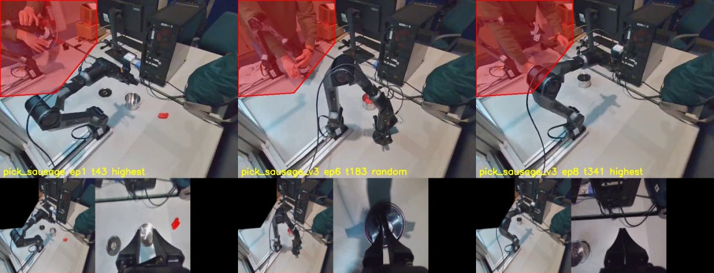

# Piper F1, part 1: the recordings, a masked front camera and the first single-task policy (sausage → pot → lid, 30 demos). The pipeline runs end to end, but the policy memorises: on held-out episodes its open-loop error (0.054 rad over the 8 executed ticks) does not beat holding the last command (0.044 rad), while on training episodes it is 0.0036 rad

**Status: thesis plan F1 (Workstream F), the data and training half.** The robot half (policy server,
robot runner, open-loop replay of 3 demos on the robot, closed-loop rollouts) is not started.
- **Code:** `9ec29d9`. The run `results/single__piper__sausage_pot_lid__seed0` was trained at that
  commit, from a clean tree.
- **Data:** 36 usable demos of one task from the 30 Oct recordings. 30 are trained on and 6 held
  out.
- **The front camera is masked** where the operator and the leader arm are, in training and (later)
  serving alike.
- **Offline open-loop check:** fitting is clean, but held-out error is no better than a do-nothing
  predictor (§5).
- **Not settled:** whether that matters closed-loop. Open-loop error is not closed-loop success; the
  robot decides.

## 1. The recordings (checked Sun 1 Nov)

- **Source:** `~/piper_datasets/pick_sausage` (22 episodes) and `~/piper_datasets/pick_sausage_v3`
  (16), recorded on 30 Oct.
  - Format: LeRobot v3.0, robot_type `piper`, one arm, 15 fps, two 640×480 h264 cameras
    (`observation.images.image`, third person; `observation.images.wrist_image`).
  - Each folder is pinned in `flowcl/data/piper_tasks.py` by a sha256 over its `meta/`, `data/`
    and `videos/` files. Recording more episodes into a folder changes the hash, and the build
    refuses until the registry is updated.
- **The task is not what the label says.** The recordings say "pick the sausage". Every demo puts
  the sausage in the pot and then the lid on the pot, starting and ending at the home pose.
  - The registry's instruction is "put the sausage in the pot and cover it with the lid".
  - The raw label is kept in the cache (`raw_labels`).
- **Excluded:**
  - `pick_sausage` episode 0: the front camera was in another pose;
  - `pick_sausage` episode 15: a 3.7 s arm return with no task.
- **Integrity:** no NaN; `index` and `frame_index` contiguous; timestamps exactly 1/15 s; every
  video has exactly one frame per parquet row; no decode errors. The adapter checks all of these.
- **Signals:**
  - `action` (7) is the leader arm's absolute joint targets (rad) and gripper target (m).
  - `observation.state` (7) is the follower's measured joints and gripper opening.
  - The state trails the action by 1–2 ticks. Mean |action − state| over the six joints is 0.0157
    rad at lag 0, 0.0079 at lag 1, 0.0078 at lag 2 and 0.0148 at lag 3.
  - **The gripper state is measured:** it reads 24.5 mm while holding the sausage under a 0
    command. The robot can send it live, unlike the Dobot's.
  - `observation.eef` / `action.eef` are not used. The axis-angle wraps at ±π.
- **Video/state sync:** image motion against joint motion (cross-correlation per episode, both
  cameras) peaks at a lag of 0–2 frames, mostly 1.
- **Joint speed** (largest joint step per tick, training episodes): p99 0.093 rad, max 0.161 rad.
  The robot runner's per-tick limit must sit above the p99.
- **Episodes:** 22–47 s (326–706 ticks). The `v3` session is faster (22–33 s). Object placement
  varies between episodes.

## 2. The front-camera mask

- **Why:** the third-person view shows the operator and the leader arm in the top left.
  - The leader arm's pose *is* the action, 1–2 ticks ahead of the robot.
  - When the policy runs alone, the leader arm sits still at home. A policy that had learned to
    read it would stall.
- **How:** `ObservationSpec.image_masks` holds polygons in the recorded frame's pixels (plus
  `mask_source_hw`).
  - `flowcl/data/images.policy_frame` fills them black, then area-resizes to 128×128. The cache
    uses it now and the server will.
  - The spec serialises the masks only when set, so LIBERO specs and every existing checkpoint
    are unchanged (tested).
  - Checkpoints carry the mask, and a cache built under another mask refuses to load.
- **Polygon:** `[[0,0], [260,0], [260,115], [150,250], [0,260]]`, chosen on review sheets of 84
  frames from all 36 episodes (`scripts/prepare_piper.py --review`): each episode's highest
  gripper tick away from home, the 12 widest joint-1 ticks, and one random tick per episode.
  - The gripper and the objects are never masked.
  - The trade-off is at the diagonal edge. When the robot raises its elbow back toward the
    operator (the end of `v3` episodes), about half of the elbow joint is blacked out. The joint
    state still carries it.
  - The first polygon, `[[0,0],[240,0],[240,110],[190,125],[140,235],[0,245]]`, left the
    operator's hand and the leader's handle visible at the edge, so it was widened.

## 3. Setup (`configs/embodiment/agilex_piper.yaml`)

- **Cameras:** `front`, then `wrist`, at 128×128 (the LIBERO input size). At this size the sausage
  is about 6×5 pixels in the front view and large in the wrist view.
- **State and action:**
  - state 7: measured joints and gripper;
  - action 7: absolute joint targets and gripper target, `joint_position`, z-scored.
- **Timing:** 15 Hz (the recording rate, no subsampling), H = 16 (1.07 s), execute_k = 8 (0.53 s).
- **No std floor.** It matters only for later tasks under frozen Task-1 stats. When F2 brings one,
  it must spare the gripper (std 0.018 m), unlike the Dobot config's single 0.2 floor.
- **Demos:** the first 30 in registry order (`pick_sausage` 1–14 and 16–21, then `v3` 0–9).
  - The hold-out is `v3` 10–15, the latest session. `n_demos=None` loads the 30 training demos
    only.
  - **This is a deviation:** the plan's proof recipe says about 15 demos. The user chose 30.
- **Policy and training:** `flowpolicy_base` (53.8M trainable, frozen DINOv2-S and CLIP), 30k steps,
  batch 64, lr 1e-4, AMP, seed 0 (`scripts/gate0.py --no-eval`, ported from `dobot-hw`).

## 4. Training

- **Time:** 15:20–16:01 (40.5 min, about 0.08 s/step), alongside a CPU test run.
- **Samples:** 13,376 over 30 demos.
- **Loss:**
  - mean logged loss per 5k steps: 0.208, 0.060, 0.043, 0.031, 0.023;
  - last 1k steps: 0.0175 (logged single batches; the last 10 average 0.0137);
  - the same range as the Dobot red run's end (0.01–0.03).

## 5. Offline open-loop check (`scripts/hw/piper_offline_check.py`)

**Method:**
- Every 8 ticks of an episode, the policy gets the cached frames and the recorded state and samples
  a chunk with fixed noise.
- It is compared with the recorded actions as mean absolute error over the six joints.
- Output: `results/single__piper__sausage_pot_lid__seed0/offline_check.json`.

**Baselines,** for scale:
- hold the current measured state for the next 8 ticks;
- repeat the last recorded command.

| Episodes | Chunks | Policy, executed 8 ticks | Policy, 16 ticks | Worst joint | Gripper | Hold state | Hold last command |
|---|---:|---:|---:|---:|---:|---:|---:|
| Held out (30–35) | 284 | **0.0542 rad** (0.049–0.058) | 0.0781 | 0.0856 | 5.5 mm | 0.0512 | **0.0443** |
| Training (0–5) | 424 | **0.0036 rad** | 0.0038 | 0.0052 | 0.19 mm | 0.0362 | 0.0303 |

**By tick within the chunk** (held out; the policy against hold-last):

| Tick | 0 | 1 | 3 | 7 | 11 | 15 |
|---|---:|---:|---:|---:|---:|---:|
| Policy | 0.028 | 0.037 | 0.053 | 0.080 | 0.102 | 0.121 |
| Hold last command | 0.010 | 0.020 | 0.040 | 0.078 | 0.114 | 0.146 |

**Readings:**
- **The policy memorises its 30 demos.** On them it is about 8× better than holding still. On new
  episodes it is no better.
  - The gap is 15× (Dobot red with 110 demos: about 6×, over 24 ticks at 30 Hz).
  - All six held-out episodes are alike (0.049–0.058), so this is not one bad episode.
- **The first command is the weak point.** On held-out episodes the predicted tick 0 is 0.028 rad
  from the recorded command; repeating the last command is 0.010 away. Typical joint motion is
  about 0.01 rad per tick.
  - Closed-loop, each replan (every 0.53 s) could start about 3 ticks of motion away from the
    current command. The runner's first-command jump check will see this.
- **Further out, the policy carries some information.** From tick 11 on it beats holding still
  (0.102 vs 0.114; 0.121 vs 0.146): it predicts the direction of motion, roughly.
- **The held-out episodes are all from the faster `v3` session,** while two thirds of the training
  demos are from the slower one. The follow-up in §8 rules this out as the main cause: a `v3`-only
  policy does worse on the same unseen episodes.
- **Open-loop error is not closed-loop success.** A memorising policy can still succeed on the
  robot if the scene stays close to the demos. The F1 proof decides.

**Cheap levers, untested:**
- **Fewer steps:** about 140 epochs at 30k steps; held-out error against intermediate checkpoints
  would show whether earlier stopping helps.
- **Actions relative to the current state:** this bounds the tick-0 offset.
- **Image augmentation.**
- **More demos:** F2 budgets about 50 per task.

## 6. Code (`9ec29d9`)

- **Configuration and spec:**
  - `configs/embodiment/agilex_piper.yaml`;
  - `ObservationSpec.image_masks` / `mask_source_hw` (`flowcl/data/spec.py`, `config.py`).
- **Data path:**
  - `flowcl/data/images.py`: `policy_frame`.
  - `flowcl/data/piper_tasks.py`: the registry, sources with hashes and exclusions, hold-out;
    raw data in `$FLOWCL_PIPER_RAW` or `~/piper_datasets`, cache in `datasets/piper/cache/`.
  - `flowcl/data/piper_adapter.py`: the v3.0 reader and checks, the HDF5 cache, `verify_cache`,
    `iter_cache_episodes`.
  - `flowcl/data/tasks.py`: `TaskRef` dispatch for suite `piper`.
- **Scripts:**
  - `scripts/prepare_piper.py`:
    - `--review` for the mask sheets;
    - `--build` for the cache, a report (`datasets/piper/report_sausage_pot_lid.json`) and the
      held-out episodes' first frames (`datasets/piper/photos/sausage_pot_lid/`, for setting the
      scene before rollouts);
    - `--cache-sheet` for the policy inputs read back.
  - `scripts/hw/piper_offline_check.py`, `scripts/queue_piper_single.sh`, and `--no-eval` in
    `scripts/gate0.py`.
- **Tests:**
  - `tests/test_images.py`;
  - `tests/test_piper_adapter.py`: a synthetic v3 dataset with two video files covering frame
    mapping, exclusions, a short video, a changed folder, the cache checks and `TaskRef`
    dispatch.
  - **The CPU suite passes.** One run covered 1,060 tests and stopped at its 50-minute timeout
    (it shared the machine with training) with no failure. The remaining 9 files (123 tests) then
    passed file by file; `test_twosided_gonogo` alone takes 14 min.
- **Smoke run:** 200 steps on 2 demos, then the offline check, end to end.

## 7. Why it does not transfer: input probes (`final.pt`, no retraining)

- **It follows the measured arm position.** With the state from 8 ticks later, the first command
  moves 0.070 rad (the state moved 0.074).
- **It uses the cameras.** With another held-out episode's frames at the same phase of the task, the
  16-tick plan changes by 0.07–0.10 rad; with black frames, by 0.14.
- **On a new layout it does not replay a demo.** Its held-out plans are as far from the nearest
  recorded training chunk (0.078) as from the truth (0.081).
- **Reading:** each object layout appears in one demo, and 30 demos at about 140 epochs are
  memorised demo by demo rather than as a rule. This is overfitting, not a pipeline fault.
- **Not in the trainer yet:** image augmentation and periodic checkpoints (for earlier stopping).

## 8. Follow-up: `v3` only, 12 demos (`f04786a`)

**Question:** does the slower `pick_sausage` session's style explain the held-out gap?

**Setup:** task `sausage_pot_lid_v3` trains on `v3` 0–11 (4,492 samples) and holds out `v3` 12–15.
The 30-demo policy never trained on those four either.
- The recipe is the same: 30k steps, about 430 epochs here against 140.
- The offline check now keys the sampling noise by recording, so both policies see the same
  noise on each episode. The 30-demo numbers below come from that rerun
  (`offline_check_v3split.json`).
- The run: `results/single__piper__sausage_pot_lid_v3__seed0`, 17:35–18:14. The logged loss was
  0.0092 over the last 1k steps.

| Held out (`v3`) | `v3` only, 12 demos | Both sessions, 30 demos | Hold last command |
|---|---:|---:|---:|
| 12 | 0.1029 | 0.0542 | 0.0443 |
| 13 | 0.1137 | 0.0586 | 0.0483 |
| 14 | 0.0750 | 0.0490 | 0.0455 |
| 15 | 0.1006 | 0.0557 | 0.0495 |
| **all, executed 8 ticks** | **0.0987** | **0.0545** | **0.0469** (hold state 0.0538) |
| all, 16 ticks | 0.1313 | 0.0775 | |
| worst joint | 0.2188 | 0.0795 | |
| training episodes 0–3 | 0.0021 | 0.0036 | 0.0373 |

**Reading:**
- **Session style is not the problem.** Dropping the other session makes every unseen episode
  worse: the error nearly doubles.
- **The 20 slower demos help.** More layouts beat matching the operator's style.
- **Fewer demos memorise harder.** Training error falls (0.0021) while held-out error rises.
- **The direction is more data per task (and augmentation), not filtering by session.**

## 9. Still to do in F1

- **The robot side:**
  - a policy server built from the checkpoint (it applies the checkpoint's mask);
  - a robot runner on the Piper SDK that sends the measured joints and gripper, with the
    `dobot-hw` safety checks;
  - **open-loop replay of 3 recorded demos** with tolerances set first;
  - the 10 closed-loop rollouts from the held-out photos, with the measured cycle time.
- **Keep the front camera where it is** until the proof is done; mark its mount. The demos and the
  rollouts must share its pose.
- **Decide** whether to try the cheap levers (§5) before the robot or after the first rollouts. §8 says more demos help; filtering by session does not.
