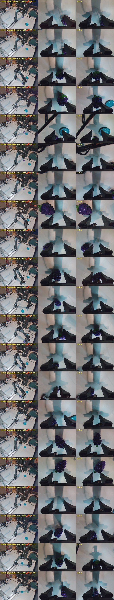

# Piper grape (Tue 3 Nov): a session recorded in the test light, a masked policy and a masked + table-cropped one. The cropped policy put the grape on the plate in 4 of 21 free-scene tries (the masked one: 0 of 4). The misses are aim, the grape beside or ahead of the fingers; and a loose grip, the gripper command back at the grape's width soon after closing

**Status: thesis plan F1, the third task on the robot.**
- **Why this task:** the milk rollouts failed under light unlike the recording's
  (`runs/2026-11-03_piper_milk_rollouts.md`). So the user recorded a new task at midday, in the
  light the robot is then tested in, and asked for a quick masked policy.
  - After the first rollouts they asked for the front camera to be cropped to the table, and drew
    the working area themselves (§3).
  - They want the policies tested **zero-shot**: no robot-side changes to the actions (for example a
    grip hold) and no relabelled actions.
- **Code:**
  - `bacdd60`: the task.
  - `b6a5d16`: the masked queue.
  - `967ec50`: the crop, its embodiment, task and queue.
  - The runs record `-dirty` only for the untracked `docs/runs/2026-11-02_piper_all_demos.md`.
  - PiperStudio `a9e82e7`, clean, for every rollout.
- **Analysis:** `scripts/hw/piper_rollout_diag.py`. This record adds `grip` and the demos' holding
  numbers, and `sheet --before/--after` and the run filters.
- **Logs:** `results/piper_rollouts/2026-11-03/` (from `~/piper_rollouts/2026-11-03`); diagnostics in
  its `diag/`.
- **Not done:** the rollouts are not annotated. Outcomes here are read from the logs and the frames
  (§4–§5). The full test suite was stopped partway after the crop change (to free the GPU); the 56
  Piper, image and spec tests pass.

## 1. The session

- **Source:** `~/piper_datasets/pick_grape`, recorded 12:14–12:59 in daylight.
  - Fingerprint `a7318705…`, pinned as `PICK_GRAPE`.
  - 40 episodes, 9,219 frames, 160–321 ticks.
  - The same features and cameras as the milk session; the jacket lies on the right table as in it.
- **The task:** pick up a soft toy grape and put it on the blue plate. The grape and plate positions
  vary.
  - Label "pick up the grape and put it on blue plate".
  - The registry's instruction is "pick up the grape and put it on the blue plate" (`GRAPE_PLATE`).
- **Nothing is held out.**
- **The demos** (`piper_rollout_diag.py demos --source ~/piper_datasets/pick_grape`):
  - the grasp is at an end height of 96–108 mm (min, p50);
  - 71 % of ticks move faster than 0.2 rad/s;
  - the command leads the measured state by 0.065 rad along the motion.
  - **While carrying the grape** (2 s from 5 ticks after the measured gripper first closes): the
    command is 38.9 mm (p50; 0–45.8 over the episodes) against 50.8 mm measured. **The operator
    squeezes 12 mm past the grape** (p50; min 0.1 mm).
- **Mask:** checked on the review sheets for episodes 0–5 and 31–35
  (`datasets/piper/review/grape_plate/`). The operator and the leader arm stay inside it; the grape
  and the plate stay visible.

## 2. Two policies

Both use Gate 0's recipe: 30k steps, batch 64, lr 1e-4, AMP, seed 0, a checkpoint every 5k, no
augmentation. The offline check covers training episodes 0–5 (fitting only): holding the state gives
0.0544 rad, holding the last command 0.0467.

| Task | Front camera | Run | Trained | Last 1k steps' loss | Offline, executed 8 ticks | Gripper |
|---|---|---|---|---:|---:|---:|
| `grape_plate` | masked (`agilex_piper`) | `results/single__piper__grape_plate__seed0` | 13:02–13:42 | 0.0170 | 0.0030 rad | 0.20 mm |
| `grape_plate_crop` | masked + cropped to the table (`agilex_piper_crop`) | `results/single__piper__grape_plate_crop__seed0` | 15:17–15:57 | 0.0168 | 0.0031 rad | 0.20 mm |

The crop costs no fit.

## 3. The crop

- **New in `967ec50`:** `ObservationSpec.image_crops`, a polygon per camera in recorded-frame pixels.
  - `policy_frame` fills the masks first. Then it fills everything outside the polygon black, cuts
    the frame to the polygon's bounding box, and resizes.
  - The spec carries the crop into the checkpoint, so the server applies it to the live camera
    exactly as in training. It also lists it in `metadata.image_crops`.
  - The crop serialises only when set: existing specs, checkpoints and caches are unchanged.
- **The polygon:** the user drew the working area on a grid of the front view.
  - It is the table's near surface up to its far edge: 20 vertices, bounding box x 144–593,
    y 195–480 (`configs/embodiment/agilex_piper_crop.yaml`).
  - Outside it, the PC, the monitor, the jacket's table and the floor are black.
  - In the 128×128 input the table is about 1.4× wider and 1.7× taller than before.
  - Every grape and plate start position of the 40 demos lies inside it.
  - Inputs: `datasets/piper/review/grape_plate_crop/cache_inputs.jpg`.
- **Limitation:** when the arm lifts the grape above the far edge, the front camera loses it. The
  wrist camera and the joint state remain.
- **Tests (in that commit):**
  - a rectangle crop equals cutting the frame;
  - outside a triangle is black inside its box;
  - masks apply before the crop;
  - bad crops are rejected;
  - crops round-trip and need the recorded size;
  - a cropped cache loads only under its embodiment.

## 4. The masked policy on the robot (14:42–14:47)

| Run | Scene | What happened |
|---|---|---|
| `144454_replay` | episode 10, placed with the overlay | **picked and placed;** joint RMSE 0.0016–0.0034 rad, max ≤ 0.011, lag 0, nothing limited |
| `144617` | episode 10 | reached, grasped, lifted, carried towards the plate; **dropped the grape at 6.4–7.0 s, just short of the plate** |
| `144703` | episode 10 | grasped, then the command opened (39 → 46 → 56 mm); stopped at 8 s |
| `144213`, `144721` | free | closed beside the grape |

**Readings:**
- **The motion follows the demo now.**
  - `144617` stays 0.05–0.18 rad from episode 10's path for its first 10 s
    (`path --episode 10 --every 2`). The milk policies under the other light were 0.2 rad off
    within 1.6 s.
  - It moves at the demos' rate: 32–79 % of chunks plan motion.
- **The drop is the grip.** In `144617` the command is 37.6 mm on a grape measured at 43.8 mm at the
  grasp, a 6 mm squeeze.
  - From 5.5 s it creeps up: 41.4, 44.0, then 46.3 mm, the grape's width and above. As the grape
    slips and the fingers open, the command follows them.
  - The replay sends the operator's commands, which squeeze, and succeeds.

## 5. The cropped policy on the robot (16:09–16:20)

**21 tries on `final.pt` and 2 on `step_020000`,** 22 on free scenes, `161940` on episode 11. You
stopped each run from the Policy tab.
- **Your count:** "barely 1 or 2 worked".
- **From the frames,** start against end:
  - **4 put the grape on the plate:** `160932`, `161037`, `161115`, `161418`, all `final.pt`, from
    free scenes with the grape starting on the table.
  - **1 more carried it over the plate:** `161940`, stopped at 32 s before releasing.

**Where the grape was just before the close** (front + wrist 0.3 s before the gripper first closes
below 85 % of its widest, and the wrist 1.5 s later: figure). Read by eye from the frames:

| Grape vs fingers | Runs | Of which on the plate at the end |
|---|---:|---|
| between them | 9 (`160932`, `161037`, `161115`, `161418`, `161444`, `161507`, `161740`, `161940`, `162036`) | 4 (+ `161940` carried) |
| ahead of them (short) | 2 | 0 |
| left of them | 3 | 0 |
| right of them | 2 | 0 |
| the plate instead | 1 | 0 |
| not in view | 4 | 0 |
| never closed | 2 (`161310`, `162020`) | 0 |



**The grip after the close** (`piper_rollout_diag.py grip`: commanded and measured opening, p50 over
0.5–1.5 s after the close; the squeeze is measured − commanded):
- **The command after the close:** p50 48.0 mm, range 36–69 mm, across the 25 runs that closed (both
  policies). The demos hold at 38.9 mm.
- **Clear squeeze:** only the runs that went on to lift at about 200 mm, `161037` (+14.5 mm),
  `161418` (+13.2) and `161940` (+7.7). There the command stayed at 36–41 mm.
- **Almost no squeeze in the others:** ±1 mm in most. The fingers stopped where they were told, at
  the grape's width or wider.
- **Two successes had no measurable squeeze:** `160932` (−0.8) and `161115` (+0.5) carried the soft
  grape wedged between the fingers.

**Readings:**
- **The crop helped the aim.** The grape was between the fingers in 9 of 21 tries (the masked
  policy: 1 of 4). It ended on the plate in 4 (the masked policy: 0).
  - Samples are small, and the scenes were not the same across the two policies.
- **Aim is the larger loss: 12 of 21 tries closed with the grape elsewhere.**
  - The misses go in every direction: ahead, left, right, out of view. So this is imprecision, not a
    fixed offset such as a moved camera.
  - With 40 demos, each grape position is seen once.
- **Grip is the second loss.** Of the 9 well-aimed tries, 4 did not lift the grape: `161444`,
  `161507`, `161740`, `162036`. All had squeeze ≈ 0.
  - The policy closes briefly to 38–40 mm, then commands back to about the grape's width, as in §4.
  - The demos squeeze 12 mm past it. The policy follows the measured opening rather than holding
    that offset.

## 6. Reading

- **Matching the light helped.** On a training layout the masked grape policy follows its demo,
  where the milk policies under other light switched between demos. The crop then helps the aim on
  free scenes.
- **Two causes remain, both in the data, as long as the policy and the executor are not changed:**
  - **Aim:** 40 demos, one per position. More demos at more positions, keeping the crop.
  - **Grip:** the demos squeeze 0–46 mm commanded (p50 38.9) on a grape measured at about 51.
    Closing the leader gripper **fully** while carrying, every demo, would give commands far below
    the grape's width. Then the policy's drift back towards the measured opening would still leave a
    squeeze.
- **Caveats:**
  - single runs, mostly free scenes, not annotated;
  - the aim classes are read by eye;
  - the uncropped policy had only 4 tries.

## 7. Next

1. **Record more grape demos.** Close the leader gripper fully while carrying, cover more grape and
   plate positions, and record in the same light. Add them to these 40.
2. **Train the cropped policy on all of them** (`queue_piper_grape_crop.sh` with the new count).
   Compare on the same layouts as today: episode 10 or 11, and a few free scenes, annotated.
3. **Rerun the full test suite** when the GPU is free.

**Reproducing the numbers:**

```bash
uv run python scripts/hw/piper_rollout_diag.py demos --source ~/piper_datasets/pick_grape
uv run python scripts/hw/piper_rollout_diag.py logs --day results/piper_rollouts/2026-11-03 --since 144200 --source ~/piper_datasets/pick_grape
uv run python scripts/hw/piper_rollout_diag.py grip --day results/piper_rollouts/2026-11-03 --since 144200
uv run python scripts/hw/piper_rollout_diag.py path --run results/piper_rollouts/2026-11-03/144617_rollout --episode 10 --every 2 --source ~/piper_datasets/pick_grape
uv run python scripts/hw/piper_rollout_diag.py sheet --day results/piper_rollouts/2026-11-03 --since 160900 --before 0.3 --after 1.5 --scale 0.3 \
    --image docs/assets/piper_grape_crop_closes.jpg
```
