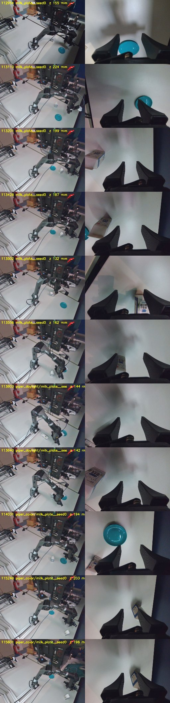

# Piper milk on the robot (Tue 3 Nov): no policy picks up the milk. The unmasked three never open the gripper; the masked three reach, stall and close beside the carton, even on a training layout where the replayed demo succeeds. Under today's light they leave the demo's path within 1.6–3.2 s and hop between other demos' trajectories

**Status: thesis plan F1, the first rollouts of the six milk policies** (`runs/2026-11-02_piper_milk.md`).
The user ran all six on the robot and none picked up the milk. Some closed beside it; some barely
moved. They asked Claude to test the policies, watch through the cameras and find the cause.
- **Code:** flowcl `91b8631` (the server). PiperStudio `a9e82e7` for every run, clean tree. That
  commit lists the unmasked runs on the Policy tab, which before it showed only `agilex_piper` runs.
- **Analysis:** `scripts/hw/piper_rollout_diag.py`, committed with this record. Its outputs are in
  `results/piper_rollouts/2026-11-03/diag/`.
- **Logs:** PiperStudio's `~/piper_rollouts/2026-11-03/`, copied to `results/piper_rollouts/2026-11-03/`
  (14 rollouts by the user, then 1 replay and 3 rollouts by Claude).
- **Who did what:**
  - 11:29–11:40: the user, on free scenes, every policy (§1).
  - 11:50–12:01: Claude drove the Policy tab. The user stood at the arm and placed the objects (§3).
- **Not controlled:** the light (daylight through the windows; the demos were recorded 16:53–17:22
  under a lamp). Single runs, one layout for the controlled tests.

## 1. The user's rollouts (free scenes)

From `piper_rollout_diag.py logs`. "Travel" is the largest joint distance from the first state
(rad). "Moving" is the share of chunks whose first 8 ticks plan more than 0.2 rad/s. "Swap" is how
far the new chunk is from the old one where it takes over: p50 / max, worst joint (rad).

| Run | Policy | s | Travel | Gripper max (mm) | Lowest end z (mm) | Moving | Limited | Swap | Tracking p95 |
|---|---|---:|---:|---:|---:|---:|---:|---|---:|
| `112954` | masked | 31.2 | 1.74 | 63 | 155 | 0.49 | 10.1 % | 0.032 / 0.16 | 0.082 |
| `113110` | masked | 28.2 | 1.54 | 46 | 216 | 0.19 | 5.6 % | 0.017 / 0.10 | 0.054 |
| `113201` | masked | 25.3 | 1.66 | 48 | 199 | 0.21 | 5.1 % | 0.025 / 0.08 | 0.068 |
| `113428` | masked | 25.8 | 1.68 | 62 | 168 | 0.52 | 6.9 % | 0.018 / 0.14 | 0.074 |
| `113502` | masked | 31.5 | 1.48 | 76 | 130 | 0.25 | 5.8 % | 0.023 / 0.07 | 0.042 |
| `113556` | masked | 22.7 | 1.43 | 70 | 151 | 0.60 | 8.4 % | 0.025 / 0.14 | 0.089 |
| `113803` | masked + daylight | 23.6 | 1.60 | 66 | 139 | 0.18 | 5.4 % | 0.017 / 0.09 | 0.078 |
| `113840` | masked + daylight | 43.6 | 1.70 | 63 | 142 | 0.09 | 4.4 % | 0.022 / 0.13 | 0.059 |
| `114031` | masked + colour | 23.1 | 1.60 | 66 | 176 | 0.30 | 6.2 % | 0.037 / 0.10 | 0.076 |
| `113323` | unmasked | 25.7 | 0.03 | 0 | 299 | 0.00 | 2.4 % | 0.025 / 0.03 | 0.021 |
| `113353` | unmasked | 14.4 | 0.01 | 0 | 302 | 0.00 | 2.2 % | 0.024 / 0.03 | 0.020 |
| `113642` | unmasked + daylight | 20.1 | 0.39 | 0 | 269 | 0.21 | 9.9 % | 0.084 / 0.17 | 0.066 |
| `113713` | unmasked + daylight | 23.7 | 1.10 | 1 | 190 | 0.44 | 8.9 % | 0.032 / 0.21 | 0.079 |
| `113950` | unmasked + colour | 13.1 | 1.09 | 2 | 203 | 0.56 | 9.9 % | 0.057 / 0.19 | 0.084 |

The demos for comparison (`piper_rollout_diag.py demos`, all 40):
- the gripper closes on the carton at an end height of 128–141 mm (min, p50);
- 64 % of ticks move faster than 0.2 rad/s, at 0.57 rad/s (p50);
- the command leads the measured state by 0.056 rad along the motion;
- |command − measured| is p50 0.030, p95 0.085, max 0.196 rad;
- the arm waits 8 ticks at home before moving (p50; 1–40).

**Readings:**
- **The unmasked three never open the gripper (≤ 2 mm).**
  - The plain one barely moves: 0.01–0.03 rad, no chunk plans motion.
  - The augmented ones wander up to 1.1 rad.
  - This is what the corner probe predicted (2 Nov record §7). They read the leader arm, which
    stands still on the robot.
- **The masked three reach, open and descend.** They open to 46–76 mm and go down to 130–216 mm,
  around the demos' grasp height. But they close where the carton is not.
  - **At the close, in the wrist camera** (figure below; frames 2 observations before the gripper
    first closes below 70 % of its widest opening):
    - in 5 runs the carton is beside or behind the fingers;
    - in 3 the gripper is over the plate, or next to it;
    - in 2 (`113502`, `113556`) the carton is between the fingers but too far forward;
    - in 1 (`113803`) neither the carton nor the plate is in view.
    - The figure has 11 rows: these 9 runs and tests 2 and 3 (§3).
  - Two runs were annotated, both as failures. The annotation form still has the sausage task's
    fields.



## 2. What is not the cause

- **The camera has not moved.** The live front frame blended 50/50 with frame 0 of episode 20 shows
  the arm base, the table edges and the PC on top of each other.
- **The arm, the executor and the placement work.** Episode 20 was replayed open-loop through the
  executor (`115036_replay`), with the milk and the plate placed by the overlay. **It picked up the
  milk and put it on the plate.**
  - Per joint, RMSE 0.0016–0.0025 rad and max 0.006–0.012 rad.
  - Gripper RMSE 0.2 mm; best lag 0 ticks; 0.7 % of ticks limited.
  - So it passes every tolerance of the deploy spec (§6.3).
- **Timing is as in the demos.**
  - In the rollouts that moved, the arm trails its command by p95 0.04–0.09 rad. That is about the
    demos' 0.085, and below the replay's own 0.102.
  - A moving chunk's tick 0 leads the measured state by +0.03 to +0.05 rad along its motion (the
    demos: +0.056). So a replan does not drag the arm back.
- **The background is not it.** In test 2 the jacket, which lies on the right table in every demo,
  was missing, and a robot car and a white bag were there instead. Test 3 put the jacket back and
  cleared the table, and changed nothing (§3).
- **The layouts are in range.** The 40 demos put the carton and the plate over most of the table,
  as the free scenes did. Tests 2–4 used a training layout anyway.

## 3. Controlled tests on episode 20's layout

**Scene:** the milk and the plate placed with the overlay on episode 20's frame 0. The plate matched
exactly; the milk to a few pixels. Each run was stopped at 45 s, unless something else ended it first.

| Test | Run | Policy (front masked) | Scene | Outcome |
|---|---|---|---|---|
| 1 | `115036_replay` | none: episode 20's actions | as recorded, jacket missing | **picked and placed**, 21.1 s |
| 2 | `115248` | colour 0.3 | jacket missing | reached the carton at ~24 s with it under the right finger, half-closed (65 → 29 mm), hovered; stopped at 45 s |
| 3 | `115601` | colour 0.3 | jacket back, right table cleared | the same; by 45 s the carton was centred between the open fingers (62 mm) at 148 mm, never closed |
| 4 | `120059` | daylight 0.3 | as test 3 | swung J1 to −2.1 rad, about 0.8 past the carton, gripper shut; PiperStudio's first-jump check stopped it at 10.8 s (J1 0.152 rad, limit 0.15) |

**For comparison, episode 20 itself:** it opens the gripper at 4.9 s, grasps at about 7 s (end
height 129 mm) and is home at 21 s.

**Chunks that plan motion:**
- the replay (the demo's own actions, cut into chunks): 0.70;
- tests 2 and 3: 0.19;
- test 4: 0.95, moving the wrong way.

**The plain masked policy was not run on this layout.** The user's runs (§1) and the image tests
(§5) cover it.

## 4. The policy leaves the episode's path and hops between demos

`piper_rollout_diag.py path`: at each observation, the distance (max over J1–J6) from the arm's state
to episode 20's path, and to the nearest state of any demo.

| t (s) | Test 2: to ep 20 | nearest demo | Test 3: to ep 20 | nearest demo | Test 4: to ep 20 | nearest demo |
|---:|---:|---|---:|---|---:|---|
| 0.0 | 0.002 | 0.001 (ep 14) | 0.014 | 0.007 (ep 4) | 0.008 | 0.002 (ep 4) |
| 1.6 | **0.200** | 0.053 (ep 31) | **0.251** | 0.079 (ep 5) | 0.046 | 0.046 (**ep 20**) |
| 3.2 | 0.271 | 0.134 (ep 11) | 0.148 | 0.079 (ep 11) | **0.342** | 0.120 (ep 31) |
| 4.8 | 0.388 | 0.109 (ep 11) | 0.359 | 0.097 (ep 11) | 0.823 | 0.103 (ep 31) |
| 6.4 | 0.344 | 0.124 (ep 19) | 0.365 | 0.088 (ep 19) | 0.888 | 0.120 (ep 31) |
| 8.0 | 0.305 | 0.133 (ep 3) | 0.271 | 0.097 (ep 36) | 0.835 | 0.183 (ep 31) |
| 9.6 | 0.320 | 0.079 (ep 2) | 0.305 | 0.075 (ep 2) | 0.697 | 0.206 (ep 31) |
| 12.9 | 0.319 | 0.111 (ep 2) | 0.277 | 0.219 (ep 2) | | |
| 16.1 | 0.335 | 0.116 (ep 2) | 0.249 | 0.234 (ep 14) | | |

**Readings:**
- **Within 1.6 s (tests 2 and 3) or 3.2 s (test 4), the arm is 0.2–0.34 rad off episode 20's path.**
  At the same time it is within 0.05–0.13 rad of some other demo, and which demo changes as it goes.
- **The base joint shows it.**
  - Tests 2 and 3 overshoot J1 to −1.67 / −1.64 rad (episode 20: −1.28). They then settle at −1.01
    to −1.08 rad, 0.2 rad short of episode 20's −1.24, close to episode 2's.
  - Test 4 follows episode 31 to −2.17 rad.
  - That is the offset the user saw.
- **From about 11 s, test 3 is 0.14–0.23 rad from any demo state.** There it mostly holds still: in
  tests 2 and 3 only 19 % of chunks plan motion. It never commits to closing.

## 5. The images, not the state, move the plan

`piper_rollout_diag.py images`, in-process (no server), `final.pt`. Each checkpoint gets the same
state with two sets of images and the same noise seeds.

**First plan at the start pose.** Episode 20's state at tick 0, with its own frame 0 or with test 3's
first frame: the same layout, the same arm pose. Error is the mean |plan − episode 20's actions 0–15|
over J1–J6, 5 seeds. At tick 15, with the episode's images, every policy is at 0.006–0.008 rad.

| Front masked, augmentation | Episode images | Today's images | J1 after 1 s (episode: −0.001) |
|---|---:|---:|---|
| none | 0.010 rad | **0.127** (12×) | −0.328 ± 0.003: turns at once |
| colour 0.3 | 0.008 | 0.048 (6×) | −0.046 ± 0.007 |
| daylight 0.3 | 0.008 | 0.050 (6×) | +0.012 ± 0.007 |

**At the states test 3 stalled in** (5–14.5 s, 9 observations × 3 seeds), with each camera from
today or from episode 20's nearest state:
- "opens" is the share of plans whose widest gripper target exceeds 20 mm;
- the widest target is the p50 over plans.

| Policy | Today's images | Episode's images | Episode front + today's wrist | Today's front + episode wrist |
|---|---|---|---|---|
| none | opens 0.41, 18 mm | 1.00, 80 mm | 0.52, 20 mm | 0.85, 74 mm |
| colour 0.3 | 0.63, 27 mm | 1.00, 80 mm | 0.78, 43 mm | 0.93, 77 mm |
| daylight 0.3 | 0.44, 19 mm | 1.00, 80 mm | 0.67, 24 mm | 1.00, 76 mm |

**Readings:**
- **At the start pose only the images differ, and they push every policy's first plan off the
  demo: 5–12× the error.**
  - Between the two frames the layout and the arm are the same, and the camera has not moved. The
    light differs. In every demo, a lamp casts hard shadows of the arm on the table; today the
    daylight is diffuse and leaves almost none.
  - Augmentation cuts the effect about 2.5× but does not remove it.
  - Only the daylight policy's first plan keeps J1 still, as the episode does. Test 4 shows it still
    left the path at 3.2 s.
- **The wrist image decides whether the gripper opens.** With the episode's wrist image all three
  open (85–100 %, 74–80 mm); with today's, 41–63 % at 18–27 mm.
  - **Caveat:** the episode's nearest state is 0.26–0.37 rad from the rollout's. So the swapped wrist
    image also shows the carton at another arm pose, not only under other light.
  - This table shows what drives the opening. It does not show that the light alone causes the stall.

## 6. Smaller: the limiter at chunk swaps

- **In the rollouts that moved, the limiter changed 4.4–10.1 % of ticks.** The two that barely moved:
  2.2–2.4 %; the replay: 0.7 %. The spec's tolerance, set for replay, is 1 %.
- **97–100 % of those ticks fall within 0.15 s after a chunk swap.** Consecutive chunks disagree
  where the new one takes over by p50 0.013–0.084 rad (worst joint), up to 0.21.
- The arm jerks at swaps, but this does not explain closing beside the carton or over the plate.
- Raising `policy.max_joint_speed_rad_s` or blending chunks (spec §11, "not now") are the options.

## 7. Reading

- **The masked policies replay demos rather than find the carton.**
  - When the images match no recording, they follow one demo for a second or two, then another.
  - They end in states no demo visited, where they mostly hold still and close beside the carton,
    or not at all.
  - Each of the 40 demos shows one carton position once. With so little data, what the policy
    learned is to tell the recordings apart, not to locate the carton.
  - It is the same finding as the sausage task's held-out demos, which were no better than
    holding still (1 Nov record §5).
- **Today's trigger is the images, most likely the light.** On the recorded images the policies
  reproduce the demo (0.006–0.010 rad); on today's, of the same layout, they do not.
- **Not separated here: would they succeed under the recording light?** Test 3 at about 17:00, with
  the same lamp, decides it.
  - If they then pick up the milk on a training layout, the light is the trigger, and demos recorded
    in daylight are the fix.
  - If they still fail, they cannot close the loop even where they were trained.
- **Caveats:**
  - single runs on one layout;
  - the light was not measured;
  - the user's 14 runs were on free scenes, mostly without annotation;
  - the image swaps (§5) mix the light with the arm pose.

## 8. Next

1. **The recording-light test:** test 3's layout at about 17:00 with the lamp, a masked policy, two or
   three runs.
2. **Data, whatever the result:** demos under daylight as well as the lamp, and more carton positions.
   Then train masked policies on all of them.
3. **The unmasked policies:** not further. They do not move without the leader arm.
4. **The limiter at swaps** (§6), after 1.
5. **PiperStudio:** the rollout annotation still asks about the sausage and the lid; the milk task
   needs its own fields.

**Reproducing the numbers** (from `results/piper_rollouts/2026-11-03`):

```bash
uv run python scripts/hw/piper_rollout_diag.py logs --day results/piper_rollouts/2026-11-03 --out results/piper_rollouts/2026-11-03/diag/logs.json
uv run python scripts/hw/piper_rollout_diag.py demos --out results/piper_rollouts/2026-11-03/diag/demos.json
uv run python scripts/hw/piper_rollout_diag.py path --run results/piper_rollouts/2026-11-03/115601_rollout --episode 20
uv run python scripts/hw/piper_rollout_diag.py images --run results/piper_rollouts/2026-11-03/115601_rollout --episode 20 \
    --checkpoint results/piper_color/single__piper__milk_plate__seed0/checkpoints/final.pt
uv run python scripts/hw/piper_rollout_diag.py sheet --day results/piper_rollouts/2026-11-03 --masked-only --scale 0.4 \
    --image docs/assets/piper_milk_grasp_moments.jpg
```
