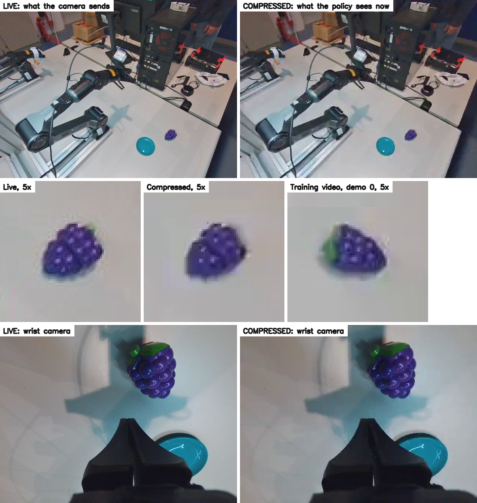

# Piper compression (Fri 6 Nov, late afternoon): the policy trained on softer images than it sees on the robot. Training frames are H.264 at crf 30, live frames are JPEGs nine times the size, and that difference alone set the plans. Passing live frames through the same video removes the first-chunk jump on the arm (J5 +0.106 → +0.016 rad) and, in replay, nearly all of the restart at home. This corrects the "memorised" reading of the two earlier records. Grapes placed (5 of 13), the miss (31 mm) and roughness (1.40) did not change, and the weak zones are hardly tested

**Status: thesis plan F1, the third record of the day, after `runs/2026-11-06_piper_resolution.md` and
`runs/2026-11-06_piper_replan.md`.**
- **Why this:** before recording new demos, the user asked whether the video resolution or anything else should
  change. Checking that found the mismatch.
- **Zero-shot:** the step changes the image and no command, like the mask and the crop, and it makes the input match
  training. This record treats it as zero-shot; the user asked for it to be built after being told so, and it is
  theirs to overrule.
- **Code:**
  - `video_roundtrip` and `PiperPolicyService(video_crf=)` in `flowcl/deploy/piper_server.py`, and `--video-crf` in
    `scripts/hw/serve_piper.py`. The server's metadata lists `video_crf`, so each rollout's log has it.
  - `av==15.1.0` added to the project; nothing else in the lock changed.
  - `video` and `zones --until` in `scripts/hw/piper_resolution_diag.py`.
  - PiperStudio is unchanged, at `df0d6ff`.
- **Logs:** `results/piper_rollouts/2026-11-06/`, runs from `155245` on; diagnostics in its `diag/`.
- **How it ran:** by hand in tmux `piper_serve`, with PiperStudio's **Connect**. After the runs below, the step became the
  server's default (`VIDEO_CRF`; `--video-crf none` turns it off), so the Policy tab's **Start server** has it too.
- **Not done:**
  - Only 4 of the 13 runs had the grape outside the zone that already worked, and no more were run.
  - The restart at home can't show on the arm, because the run now ends there.
  - The rollouts are not annotated. Outcomes are read from the frames (`diag/outcomes_by_eye.json`).
  - Milk has not been tried with the step.

## 1. The mismatch

| | Training frames | Live frames |
|---|---:|---:|
| Path | camera → PNG → H.264 (libx264, crf 30, yuv420p, I and P frames alternating) → OpenCV decode | camera → JPEG quality 80 |
| Front camera, per frame | 8.5 kB | 78 kB |
| Sharpness on the table crop | 329 | 458 |

Sharpness is the Laplacian variance of the table crop's box. `recorder.py` sets the codec and leaves lerobot's default crf
of 30. The two decoders agree exactly on a training frame (cv2 and PyAV, 0.00/255), so the decoder is not part of it.

The earlier evidence looked like something else: recorded frames gave a still plan and live frames a moving one, and on
that the records concluded the policy had memorised its 40 training images. Those recorded frames were the compressed ones.

## 2. In replay

Through the server's own code on the CPU (`video`): live frames as sent, and the same frames through the video.

| Check | 336 px plain | 336 px daylight |
|---|---:|---:|
| First plan, J5 entry, as sent | +0.223 rad | +0.128 rad |
| Through the video | **−0.009** rad | **+0.014** rad |
| Plans at the start pose leaving it, as sent | 11 of 12 (`124619`) | 7 of 9 (`125516`) |
| Through the video | **2** of 12 | **0** of 9 |

A first test with the ffmpeg command line gave −0.011 and −0.004 rad and 0 of 12, with sharpness 316. The server's step gives
348, which is why it does slightly less. The recorded 329 lies between them.

Plans in the 2 s before a close also move, by 0.06–0.08 rad on the worst joint (one-off check on `125155`, `151109`,
`151359`), so the step could change aim too.



## 3. The step

`video_roundtrip` encodes each frame with libx264 at crf 30 in yuv420p and decodes it, before the mask, crop and resize.
Each call is one key frame, where half of a recording's frames are P frames.

- **Speed:** 5.5 ms a frame. Round trip on live frames 68 ms (it was 55), and in the rollouts p50 69 ms, max 88 ms.
- **Tests:** the frame softens and keeps its shape and colour, the same frame gives the same result, and the step only
  runs when asked for. The 19 tests in `tests/test_piper_server.py` pass.

## 4. On the arm (15:52–15:58, 13 runs)

336 px daylight, 8 ticks, Blend off, free scenes. Against every earlier run of the same setup:

| | Before (30 runs) | With the step (13 runs) |
|---|---:|---:|
| First-chunk J5 entry | +0.106 rad | **+0.016 rad** |
| On the plate | 13 (+3 unclear) | 5 (+1 unclear) |
| Median miss | 29 mm | 31 mm |
| Roughness | 1.36 | 1.40 |
| Peak joint acceleration | 10.6 | 11.2 |
| First close | 4.5 s | 4.9 s |
| Worst joint step at a change | 0.044 rad | 0.046 rad |
| Backward while moving | 77 % | 76 % |

Only the first line clearly changed. For roughness, peak acceleration and first close, a Mann-Whitney test gives p 0.97, 0.22
and 0.29 (a one-off).

**The user felt the motion was less jerky.** The start is: the lurch is gone. Over the whole run the logs show no change.
So the replan steps of `runs/2026-11-06_piper_replan.md` §5 are not from this.

**By zone** (the map of the replan record):

| Grape's y | Tries | On the plate |
|---|---:|---:|
| under −250 | 9 | 5 (+1 unclear) |
| −250 to −170 | 1 | 0 |
| −170 to −80 | 2 | 0 |
| −80 and over | 1 | 0 |

The grape was in the zone that already worked for 9 of 13. Scene 6 of the replan record (`155245`) failed for the third time, at
47 mm. **So this says little about the weak zones.**

**The error may have moved.** With 12 closes, against 42 before:

| | Before | With the step |
|---|---:|---:|
| Median error x | −1 mm | **+28 mm** |
| Median error y | −13 mm | +2 mm |
| Slope x | 1.02 | 0.88 |
| Slope y | 0.86 | 0.91 |
| Scatter x, y | 20, 28 mm | 18, 16 mm |

The total miss is the same, but the sideways pull that the replan record described is smaller and an overshoot in x has
appeared, with less scatter. Twelve closes on mostly one zone can't separate a real shift from the scenes chosen.

## 5. What this corrects

- **`runs/2026-11-06_piper_resolution.md` §4, §8, §10:** the policy did not memorise standing still. The first-chunk jump and the
  restart come from the images being sharper than in training.
- **`runs/2026-11-06_piper_replan.md` §6–§8:** the 0.86 slope was measured without the step, so the case for weighting new demos by
  zone needs measuring again. The hold at the end and the quick start are probably not needed.
- **`runs/2026-11-03_piper_milk_rollouts.md`:** "today's frame gives 5–12× the error of the recorded frame", put down to the light, may
  be this too. It was never tested.

**Why so small a change moves the plans is not established.** The frames look nearly the same to a person. DINOv2 tokens respond to
fine texture, which fits, but nothing here shows it.

## 6. On recording

The question that started this:
- **Resolution, 640×480 at 15 fps: keep it.** Changing it means new masks and crops, and old and new demos could not be combined.
  At 336 px the crop's 285 px of height is already enlarged, so more pixels could help, but that would be a separate experiment.
- **Video quality: keep crf 30 for now,** so old and new demos match, with the step on.
- **A hold at home needs a code change.** With `recording.end_at_home` the recorder saves the episode as the arms arrive, which is why
  no demo has one.

## 7. Next

The user chose to stop testing here and make the step the default, without the weak-zone runs. All five Piper datasets, both
cameras, were recorded at crf 30, so it fits every policy so far. Any later runs will show what this record could not.

1. **Runs in zones 1 and 2** of the map, whenever the robot is next used. They decide whether new demos are needed.
2. **Compare the x error** in those runs. If +28 mm is real, it is the next thing to explain.
3. **Close the sharpness gap,** 348 against 329: P frames in the step, or a higher crf. Replay can check it before the arm does.
4. **Try milk with the step** under the lamp, and in daylight.
5. **Train milk 336 daylight** (`pkill -CONT -f 'scripts/[g]ate0.py'`), which is still paused.

**Reproducing the numbers:**

```bash
D=results/piper_rollouts/2026-11-06
uv run python scripts/hw/piper_resolution_diag.py video --day $D --checkpoint results/single__piper__grape_plate_crop336__seed0/checkpoints/final.pt \
    --figure docs/assets/piper_live_vs_compressed.png
uv run python scripts/hw/piper_resolution_diag.py video --day $D --checkpoint results/piper_daylight/single__piper__grape_plate_crop336__seed0/checkpoints/final.pt \
    --home-run 125516 --home-from 17.6 --samples 9
uv run python scripts/hw/piper_resolution_diag.py first --day $D --since 124400 --checkpoint-has daylight
uv run python scripts/hw/piper_resolution_diag.py smooth --day $D --since 124400
uv run python scripts/hw/piper_resolution_diag.py aim --day $D --since 155000
uv run python scripts/hw/piper_resolution_diag.py zones --day $D --since 155000
uv run python scripts/hw/piper_resolution_diag.py zones --day $D --since 124400 --until 155000
uv run python scripts/hw/piper_rollout_diag.py grip --day $D --since 155000
```

The ffmpeg test of §2, the plan shift before a close and the Mann-Whitney tests were one-off checks and were not kept.
