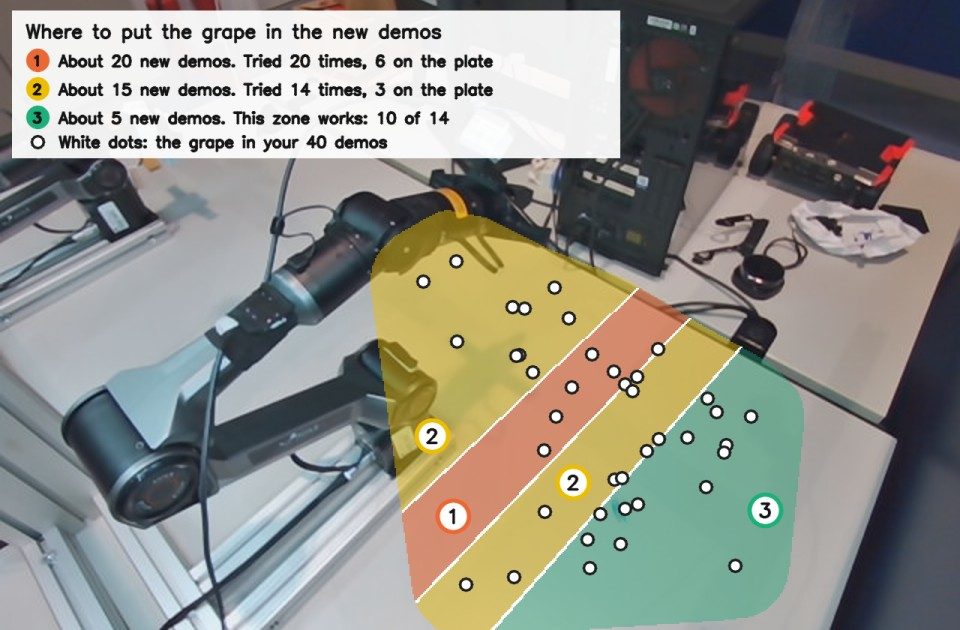

# Piper replan interval (Fri 6 Nov, afternoon): replanning every 4 or 12 ticks is no better than the policy's 8. In six near-matched pairs, 8 and 12 tie (3 grapes placed each, 30 and 28 mm, roughness 1.45 and 1.46). The scene decides instead: the close follows the grape at slope 0.86 along the table's y, so aim is pulled sideways, and only one zone of the table works (10 of 14 placed, against 9 of 34 elsewhere). Stay on 8 and record better demos

**Status: thesis plan F1, the follow-up to `runs/2026-11-06_piper_resolution.md`.**
- **Why this:** aim was the main loss left at 336 px, so the question was whether execution could improve it
  without new data or training.
- **Zero-shot:** every command in these runs is one the policy sent, unlike the blend. But LIBERO's protocol
  replans every 8 ticks, so runs at 4 and 12 are reported apart from the main result. Whether they would count as
  zero-shot was left to the user, and is moot now that they lost.
- **Code:** PiperStudio, branch `policy-picker-groups`, not pushed or merged: `483baaf` (replan every 4), `df0d6ff`
  (a choice of 4, 8 or 12, and a deadline that fits). flowcl adds `zones` and `smooth --interval` to
  `scripts/hw/piper_resolution_diag.py`.
- **Logs:** `results/piper_rollouts/2026-11-06/`, runs from `144919` on; diagnostics in its `diag/`.
- **Not done:**
  - The planned 10 pairs on marked scenes became 6 pairs on scenes rebuilt by eye, and the 4-tick runs are not paired.
  - In every pair the 12-tick run came first.
  - The rollouts are not annotated. Outcomes are read from the frames (`diag/outcomes_by_eye.json`).
  - The new runs are not repeated at other times or on other seeds.

## 1. What was expected

At 8 ticks a new plan arrives every 0.53 s, and a reply takes 55 ms. The blend had made the miss slightly worse by
delaying each new plan, which suggested that fresh images are what aim the arm. So replanning more often should aim
better. That was wrong: see §3.

The user then proposed going slower, at 16. Fewer replans mean fewer backward steps, and the arm commits to each plan
for longer.

## 2. The interval

The server reports `execute_k` and does not use it, so only PiperStudio changes and nothing is retrained.

The Policy tab offers 4, 8 or 12 (`policy.replan_choices`), the policy's own 8 by default and at every start. It
applies to rollouts only and can't change during a run. Each `meta.json` has `execute_k`, the interval used.

**How slow it can go.** A plan has 16 targets, ticks 0–15, and the old plan must last until the reply comes.

| Replan every | Left for a reply | |
|---|---:|---|
| 8 | 0.47 s | the policy's own, deadline 0.4 s |
| 12 | 0.20 s | **the slowest in use**, deadline 0.19 s |
| 13 | 0.13 s | refused by the config: the slowest reply so far took about 0.1 s |
| 14 | 0.07 s | under the 55 ms reply plus any margin |
| 16 | none | the arm would run out of targets and stop at every replan |

The 0.4 s deadline assumed the old chunk could not run out first. `reply_deadline_s` now ends 0.01 s before it does.
The first request keeps 0.4 s, since the arm only holds while it waits (first replies took up to 89 ms). A
test stops a late reply at 12 ticks. **No run hit the shorter deadline:** the slowest reply at 12 ticks was 67 ms.

## 3. Every 4 ticks (14:49–14:51, 6 runs on `483baaf`)

336 px daylight, free scenes.

| Run | Miss | What happened |
|---|---:|---|
| `144919` | | hovered, never closed, stopped at 13.7 s |
| `144946` | 28 mm | closed with the grape in its fingers, no squeeze (57 mm commanded), and stayed there until stopped at 15.9 s |
| `145012` | | never closed, the grape beside the fingers, stopped at 8.2 s |
| `145033` | 2 mm | **placed,** back at the start pose at 17.1 s |
| `145102` | 62 mm | stalled over the grape until stopped at 26.4 s |
| `145137` | 38 mm | closed beside the grape, stopped at 7.4 s |

**1 of 6 placed**, median miss 33 mm. The user's verdict: no real help. Replans twice as often means each step is smaller
(0.034 rad) but they come twice as often, 81 % of them backwards while moving, and roughness rises to 1.55. Two runs
stall, which fits being pulled back more often, though six runs can't show that.

## 4. Every 12 ticks against 8 (15:08–15:14, 12 runs on `df0d6ff`)

336 px daylight, six pairs. The plate positions match within 6 mm. The grapes were set by eye and are 3–24 mm
apart, except pair 5.

| Pair | Plate | Grape at 12 → miss | Outcome at 12 | Grape at 8 → miss | Outcome at 8 |
|---:|---|---|---|---|---|
| 1 | (140, −291) | (248, −144) → 24 mm | closed empty, `150856` | (258, −150) → 17 mm | **placed,** `150924` |
| 2 | (96, −181) | (280, −262) → 26 mm | **placed,** `150953` | (303, −257) → 39 mm | carried to the plate, stopped by a J1 first jump at 20.9 s with the grape still held, `151027` |
| 3 | (163, −289) | (269, −91) → 44 mm | closed empty, `151109` | (257, −88) → 48 mm | closed empty, `151125` |
| 4 | (284, −174) | (176, −277) → 30 mm | **placed,** `151154` | (164, −294) → 21 mm | **placed,** `151224` |
| 5 | (135, −182) | (195, −307) → 13 mm | **placed,** `151257` | (272, −320) → 21 mm | **placed,** `151319` |
| 6 | (66, −234) | (252, −162) → 55 mm | closed empty, `151359` | (249, −162) → 43 mm | closed empty, `151417` |

- **Pair 5 is the loosest:** its grapes are 79 mm apart.
- **Scenes 3 and 6 fail at both intervals, scenes 4 and 5 work at both.** Pairs 1 and 2 split one each, if `151027` is
  counted against 8.

## 5. The intervals together

| | Every 4 | Every 8, same session | Every 12 | Every 8, 12:46–13:46 |
|---|---:|---:|---:|---:|
| Runs | 6 | 6 | 6 | 24 |
| On the plate | 1 | 3 (+1 unclear) | 3 | 10 (+2) |
| Median miss | 33 mm | 30 mm | 28 mm | 29 mm |
| Roughness | 1.55 | 1.45 | 1.46 | 1.36 |
| Worst joint step at a change, p50 | 0.034 rad | 0.041 rad | 0.046 rad | 0.046 rad¹ |
| Backward while moving | 81 % | 74 % | 73 % | 77 %¹ |
| Near changes against elsewhere, squared | 1.38× | 2.81× | 4.18× | 2.35×¹ |

¹ All 336 px runs from 12:46 to 13:46, blended ones included, as in the 6 Nov record.

**The interval moves the roughness about, and does not remove it.** Slower replans put more of it at fewer moments.
Steps grow only a little with the interval, so plans disagree by a similar amount however old the last one is, and
this is not plain drift of an old plan. They are still mostly backwards at every interval.

**Aim does not respond to the interval.** So fresher images are not what limits it, and §1's reasoning was wrong. The
blend's slightly larger miss was within what six runs can show.

## 6. The scene decides

All 48 zero-blend 336 px runs at any interval that moved, by where the grape started:

| Grape's y on the table | Tries | On the plate | Unclear | Demos' grapes |
|---|---:|---:|---:|---:|
| under −250 | 14 | **10** | 2 | 14 |
| −250 to −170 | 9 | 2 | 1 | 10 |
| −170 to −80 | 20 | 6 | 1 | **6** |
| −80 and over | 5 | 1 | 0 | 10 |

**Aim is pulled sideways.** The gripper's close against the grape, 42 closes (`zones`):

| | Slope | r | Scatter |
|---|---:|---:|---:|
| x | 1.02 | 0.98 | 20 mm |
| y | **0.86** | 0.93 | 28 mm |

In y the close falls short of the grape towards the demos' centre: median error −27 mm for grapes at −170 and over, −6
mm from −250 to −170, and +8 mm under −250 (the demos' picks centre on y −165). With no grape placed from a miss above 31
mm, −27 mm uses up nearly all the margin before any scatter. The 5 Nov slope at 128 px was 1.0, on 21 closes and a
different measure; the two are not compared here.

**This corrects the 6 Nov record's reading.** Distance to the nearest demo does not predict the miss (Spearman 0.05, n
26), and that made coverage look irrelevant. It misses a pull along one axis. The −170 to −80 band has the fewest demos
and took the most tries. But density is not the whole story: −250 to −170 has 10 demos and placed 2 of 9.

**Where the zones are.** In the front view the bands run diagonally, lower left to upper right, with y growing towards
the upper left. They are not "the upper half of the view".



## 7. Reading

- **Stay on 8.** Neither 4 nor 12 helps, and 8 keeps the robot on LIBERO's protocol. The choice stays on the tab, at 8.
- **Execution tuning is finished.** Blend, 4 and 12 ticks all leave aim where it was.
- **Why y and not x is not known.** It could be how the demos are spread, or how the view shows that direction. A shrink
  towards the demos' centre is what a policy does when it generalises imperfectly, which fits the memorising seen in
  the first plans.
- **Caveats:**
  - six pairs, 12 ticks always first, scenes rebuilt by eye;
  - the user chose all the scenes, so the zones are not a random sample, and some tries repeat a scene;
  - zone counts mix daylight (42) and plain (6) and all three intervals;
  - the miss has the homography's 9 mm (p50) in it, and its fit is on these same demos.

## 8. Next

1. **Record about 40 new demos** at midday, by the map: about 20 in zone 1, 15 in zone 2, 5 in zone 3. Hold still at home for
   1–2 s at the end, and start moving straight away.
2. **Train 336 px daylight on old and new demos,** with 5 held out for an offline check (about 2h50).
3. **Compare on today's six scenes,** since pairs 3 and 6 fail at any interval: they are the test.
4. **Train milk 336 daylight** (`pkill -CONT -f 'scripts/[g]ate0.py'`). Recording does not need the GPU; rollouts do.

**Reproducing the numbers:**

```bash
D=results/piper_rollouts/2026-11-06
uv run python scripts/hw/piper_resolution_diag.py aim --day $D --since 144800
uv run python scripts/hw/piper_resolution_diag.py smooth --day $D --since 144800 --interval 4
uv run python scripts/hw/piper_resolution_diag.py smooth --day $D --since 144800 --interval 8
uv run python scripts/hw/piper_resolution_diag.py smooth --day $D --since 144800 --interval 12
uv run python scripts/hw/piper_resolution_diag.py zones --day $D --since 124400 --figure docs/assets/piper_demo_regions.jpg
uv run python scripts/hw/piper_rollout_diag.py grip --day $D --since 144800
```
