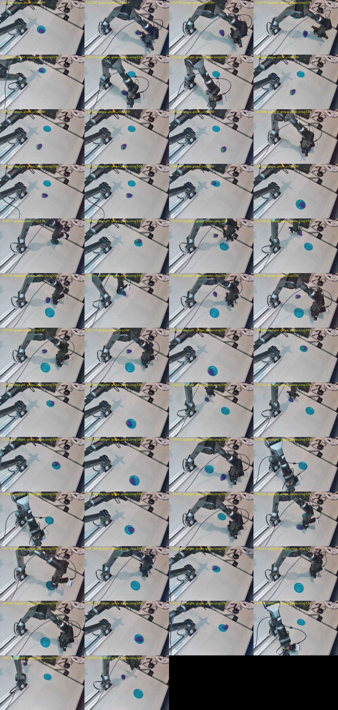
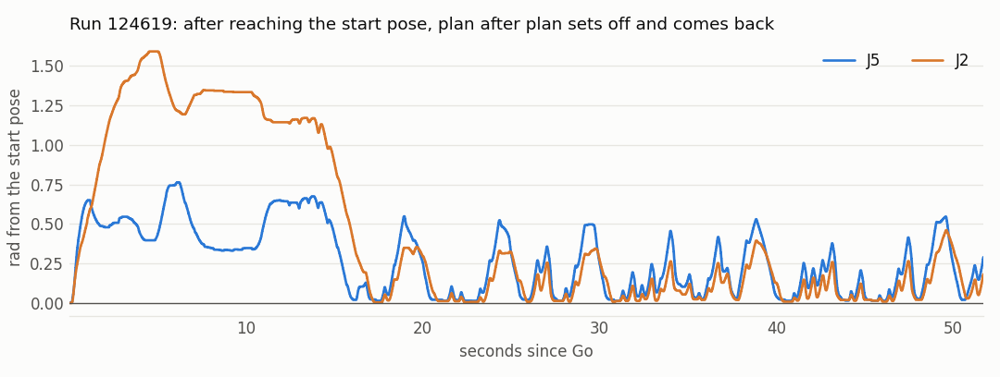

# Piper resolution (Fri 6 Nov): the table crop at 224 and 336 px on grape and milk. Finer input aims better: median miss 54 mm at 128 px, 31 at 224, 27 at 336, and the grape reached the plate in 12 of 30 tries at 336 px against 4 of 23 at 128. No grape was placed from a miss above 31 mm. A J5 first-jump limit had to be raised before 336 px could run at all. The motion is rougher than the demos at each replan, and the arm restarts its reach at the start pose. A blend at replans was smoother but not better, and stays off

**Status: thesis plan F1, the grape task's question of 5 Nov answered on the robot.** Follow-up, including a
correction of §6's reading on coverage: `runs/2026-11-06_piper_replan.md`.
- **Why this:** on 3 Nov the 128 px cropped policy missed the grape in 12 of 21 tries. The record's
  reading was that aim needs more demos. An offline check on 5 Nov pointed at the input instead (§1).
- **Zero-shot:** the user's rule stands: no robot-side changes to the actions and no relabelled
  actions (`runs/2026-11-03_piper_grape.md`). All results here are zero-shot except the blended runs of
  §9, which are reported apart.
- **Code:**
  - flowcl: `95587fb` (the queue), branch `piper-resolution`, not merged.
  - PiperStudio: branch `policy-picker-groups`, not pushed or merged: `e41cb20` (the picker), `b373268`
    (J5's limit), `c20dd04` (blend and the end at home).
- **Analysis:** new `scripts/hw/piper_resolution_diag.py`. `piper_rollout_diag.py` now skips probes and
  runs refused at their first chunk, which used to crash `logs` and `grip`.
- **Logs:** `results/piper_rollouts/2026-11-06/` (from `~/piper_rollouts/2026-11-06`): 54 rollouts and 1
  probe; diagnostics in its `diag/`.
- **Not done:**
  - Milk 336 daylight is not trained. Its queue is paused with SIGSTOP (§2).
  - Milk has not been tested under the lamp it was recorded under (§5).
  - Only `124619` is annotated, on a form that asks about the sausage and the lid. Outcomes here are read
    from the last frames; `diag/outcomes_by_eye.json` lists them.
  - Scenes are free and differ between policies, and these are single runs.

## 1. The question

**At 128×128 the frozen DINOv2 gives 9×9 patches, about 102 × 71 mm of table each.** The 50 mm grape
fits in one. 128 was inherited from LIBERO's stored frames.

The offline check of 5 Nov read the grape's position from frozen front-camera tokens on live frames, with
a fixed readout (median error, 20 / 39 demos): 128 px 132 / 80 mm, 224 px 37 / 30 mm, 336 px 18 / 16 mm.
A colour blob's floor is about 10 mm. That showed the information is in the tokens at 224 and 336 px, not
that a policy would use it. Its scripts were not kept, so these four numbers can't be reproduced.

## 2. Eight policies

The table crop of 3 Nov, at two sizes, on both tasks, each without and with daylight 0.3. Gate 0's recipe:
30k steps, batch 64, lr 1e-4, AMP, seed 0, a checkpoint every 5k. No random shifts: they would move the
image by about the precision this is after. Queue `scripts/queue_piper_resolution.sh`, tmux `piper_res`,
started Thu 5 Nov 22:12. Log: `results/piper_queue/resolution/queue.log`.

The offline check covers training episodes 0–5 (fitting only). Holding the last command gives 0.0467 rad
on grape and 0.0313 on milk.

| Policy | Run | Trained | Last 1k steps' loss | Offline, executed 8 ticks |
|---|---|---|---:|---:|
| grape 224 | `results/single__piper__grape_plate_crop224__seed0` | Thu 22:12–23:32 | 0.0172 | 0.0031 rad |
| grape 224 daylight | `results/piper_daylight/…grape_plate_crop224…` | 23:33–00:54 | 0.0218 | 0.0046 rad |
| grape 336 | `results/single__piper__grape_plate_crop336__seed0` | 00:54–03:42 | 0.0167 | 0.0031 rad |
| grape 336 daylight | `results/piper_daylight/…grape_plate_crop336…` | 03:42–06:33 | 0.0212 | 0.0044 rad |
| milk 224 | `results/single__piper__milk_plate_crop224__seed0` | 06:33–07:54 | 0.0191 | 0.0033 rad |
| milk 224 daylight | `results/piper_daylight/…milk_plate_crop224…` | 07:54–09:15 | 0.0240 | 0.0043 rad |
| milk 336 | `results/single__piper__milk_plate_crop336__seed0` | 09:15–12:04 | 0.0194 | 0.0033 rad |
| milk 336 daylight | paused | not trained | | |

- **Offline fit says nothing about resolution:** the 128 px crop gives 0.0031 too. Only the robot can
  tell. Daylight costs about 0.0012 rad of fit.
- **Training time:** 40 min at 128 px, 80 at 224, 170 at 336, 4.2× the 128 px time per step.
- **The pause:** the queue's last run was stopped with SIGSTOP at 12:04:57, as it started, to free the GPU
  for the robot. It never reached the GPU. It resumes with `pkill -CONT -f 'scripts/[g]ate0.py'`.

## 3. Serving them

Each of the seven policies was started from PiperStudio and sent 25 live camera frames at the start pose,
with the GPU otherwise idle. All 175 replies were valid 16×7 chunks.

| Input | Policies | Policy, p50 | Round trip, p50 | Worst |
|---|---:|---:|---:|---:|
| 224 px | 4 | 41–42 ms | 51–53 ms | 95 ms |
| 336 px | 3 | 44 ms | 55 ms | 86 ms |

- **The 128 px rollouts of 3 Nov:** p50 about 51 ms, worst 99 ms. Resolution costs almost nothing in
  serving. The 4.2× of training does not carry over: an estimate of 170 ms made from it before this
  measurement was wrong.
- **The server's inputs are the right size:** both cameras came back 336×336, the front cropped to the
  table with the grape and the plate visible.
- **Not measured:** latency with training running. No rollout has ever shared the GPU with training.

**The picker:** PiperStudio's list was 111 checkpoints under 21 run headers. It now has one row per run
under its task, newest first, for example `336 px crop · no aug · 40 demos · 11-06 03:42`, and the
checkpoint in a second list (`e41cb20`).

## 4. First session (12:22–12:29, 18 runs): the 336 px policies are refused

PiperStudio with the 0.15 rad limit on J1–J5. All on free scenes, at midday, as the grape was recorded.

| Policy | Runs | Refused at the first chunk | On the plate |
|---|---:|---:|---:|
| grape 224 | 3 | 0 | 1 (`122255`) |
| grape 224 daylight | 4 | 0 | 1 (`122447`) |
| grape 336 | 4 | 4 | 0 |
| grape 336 daylight | 3 | 2 | 0 |
| milk 336 | 1 | 1 | |
| milk 224 | 3 | 0 | |

**Seven of eight 336 px runs never moved:** J5's entry was 0.18–0.30 rad ahead of the arm, against the
limit of 0.15.

**The check was right about what it saw.** The demos stand still at the start pose: first motion after p50
0.43 s (0.07–1.67), J5's target 1 tick in within −0.02 rad (p50; largest 0.17). The 336 px plans start the
reach at once.

**The images set this, not the arm.** The first plan replayed on the CPU, J5's entry at p = 0.9 minus the
state (p50 over 6 live scenes or 5 training episodes, 2 seeds):

| Policy | Recorded frames | Live frames | Live frames, recorded state | Recorded frames, live state |
|---|---:|---:|---:|---:|
| 128 crop | −0.019 | +0.085 | +0.088 | −0.024 |
| 224 | −0.017 | +0.042 | +0.047 | −0.022 |
| 336 | −0.016 | **+0.223** | +0.257 | −0.023 |
| 336 daylight | −0.019 | +0.100 | +0.086 | −0.023 |

- **Swapping the state changes nothing;** swapping the images changes everything. The replay matches the
  robot (+0.19 to +0.30 at 336 px).
- **Most likely the policy memorised standing still for its 40 training images,** and on a new scene
  starts moving. This is not proven: nothing is held out on grape.
- **It is not simply resolution:** 224 px jumps less than 128 px. Daylight halves it at 336 px.
- **At 336 px it needs both cameras live:** live front with recorded wrist gives +0.084, recorded front
  with live wrist −0.013.

**The change (`b373268`):** `policy.max_first_jump_j5_rad`, 0.35 rad, as J6 got its own limit on 2 Nov. J1–J4
stay at 0.15. It decides whether a chunk may run and changes no command, so runs stay zero-shot. The 1.5
rad/s speed limit still paces every joint. Replayed through `check_chunk` on 2, 3 and 6 Nov (4,206 chunks;
matching the logged checks on all 2,019 chunks of 3 and 6 Nov), only these seven refusals change.

**Run code:** the runs of this section log PiperStudio `a9e82e7`, dirty. The tree was what `e41cb20`
committed, which changes the picker and not the control path.

## 5. Milk: not a fair test

Milk was recorded under the lamp at 17:00, and these runs were at midday, the mismatch of 3 Nov. None
picked the carton up.

| Run | Policy | What happened |
|---|---|---|
| `122809` | 336 | refused, J5 0.211 rad |
| `122829` | 224 | closed at z 154 mm and knocked the carton over |
| `122851` | 224 | stopped at 4.9 s, J3 0.181 rad at a chunk change |
| `122910` | 224 | stopped by the user at 11 s, never closed |

These four say nothing about the policies. The daylight milk policies were not tried.

## 6. Second session (12:46–12:56, 17 runs): 336 px works

PiperStudio `b373268`, clean. **No first-chunk refusal.** Then a third session, §9, added 13 more runs of 336 px
daylight without the blend.

| Input | Tries | Closes | Median miss | On the plate | Unclear |
|---|---:|---:|---:|---:|---:|
| 128 crop (3 Nov) | 23 | 21 | 54 mm | 4 | |
| 224 | 7 | 7 | 31 mm | 2 | |
| **336** | **30** | **26** | **27 mm** | **12** | 3 |
| of which plain | 6 | 6 | 18 mm | 2 | 1 |
| of which daylight | 24 | 20 | 29 mm | 10 | 2 |

**How the miss is measured** (`aim`): the grape's pixel in frame 0, the largest purple blob inside the table
outline, maps to the table through a homography fitted on the 40 demos (frame 0 pixel to the end pose at the
close), and the miss is the distance to where the gripper first closes.
- The fit: residual p50 9.4 mm, p90 26 mm, 24 of 40 inliers, so differences under about 10 mm mean little.
- **It reproduces 3 Nov:** 54 mm against 57 from the earlier scripts, and 4 grapes on the plate by the
  last-frame rule, the record's count by eye.
- "On the plate" is the last frame, or the frame at the return home for `125003` (below). "Unclear": the arm
  hides the plate (`124811`, `125123`, `134114`).



**Aim decides it.** All 32 closes since 12:46, blended runs included:

| Miss | Closes | On the plate | Unclear |
|---|---:|---:|---:|
| under 25 mm | 13 | 8 | 2 |
| 25–32 mm | 8 | 6 | 1 |
| 32 mm or more | 11 | **0** | 0 |

The largest miss among the 14 placed is 31 mm. The fingers open to about 70 mm round a 51 mm grape, so the
margin across them is only about 10 mm; the miss here has no direction, so some of it lies along the fingers.

**The grip came right too.** Across the 32 closes the command after the close is p50 41.2 mm (35.1–73.8),
against 48.0 on 3 Nov and the demos' 38.9.
- 18 of 32 closes show a clear squeeze (over 5 mm), against 3 of 25 on 3 Nov.
- All 14 placed runs squeezed by 9–16 mm, at commands of 35–42 mm. None placed without it.
- The 3 Nov record read this as a data problem, to fix by closing the leader gripper fully. These policies
  learned it from the same 40 demos, so that re-recording is not needed for grip.

**Plain against daylight is not settled.** The user judged daylight much better. The logs give 2 of 6 (+1
unclear) against 10 of 24 (+2), and 18 mm against 29 mm.
- `125256` and `125310` (plain) on one scene missed by 99 and 97 mm, and `125409` (daylight) on the same scene
  by 29 mm and placed it. So the plain policy's misses repeat, as on 3 Nov.
- Six plain runs are too few.

**A correction about `125003`:** the frames show the grape on the plate at 18.2 s and the user's hand moving
it off at 21.9 s, as the arm set out again. It counts as placed, and it is not an example of §8.

## 7. The motion is rougher than the demos, at each replan

Roughness over each run's first 16 s (`smooth`):

| | Roughness (rad/s²) |
|---|---:|
| Open-loop replays (3) | 0.89 |
| Demos | 1.06 |
| 336 daylight (24) | 1.36 |
| 336 plain (6) | 1.75 |

**The robot and the executor are not the cause:** a replay through the same executor is as smooth as a demo.

**The replan is.** Every 8 ticks the new chunk replaces the old one.
- The target steps by 0.046 rad on the worst joint (p50; p95 0.138; 928 changes, all 336 px runs since 12:46),
  about twice a second.
- While moving, the step is backwards in 77 % of 496 changes (p50 −0.032 rad along the motion): the new plan
  starts nearer the arm than the old one had got to.
- Squared roughness is 2.35× higher around changes than elsewhere.

**It is not sampling noise.** The target step replayed on the CPU on `124916`, 14 chunk changes, 2 seeds: 0.040
rad with a new seed each request, 0.039 with the same seed. So a fixed seed would not help.

Why plans disagree is not established. The arm tracks as it did in the demos (command minus measured p95
about 0.1 rad in both).

## 8. It restarts at the start pose

**The demos end where they start:** 0.009 rad from the start pose (p50; largest 0.017), gripper closed, about
4.6 s after the release, and still moving (0.42 rad over the last second). There is no hold at the end. So the
pose appears only as "about to begin", and the state cannot tell the two apart.

**On the robot the policy sets off again**, with plans of about +0.2 rad on J2 and J5, the size of the first
chunk's jump in §4, so very likely the same cause.
- `124619`: at the start pose from 17 s, the grape on the plate, no hand in view. 41 of 46 later plans point
  away, and the arm goes out and back until a J2 first jump stops it at 51.7 s. This is the oscillation the
  user saw.
- `125516`: one trip of 0.37 rad at 21.5 s, then back.
- `124916`, `125436`, `125409` stayed at the pose until stopped, 2–9 s (though all 4 late plans of `125409` point
  away).



**After the release, some runs never leave.** `125123` stays near the plate for 11 s, closing and reopening the
gripper, with J2 and J5 drifting against each other by about 0.3 rad.

**The change (`c20dd04`):** a rollout now ends, as a normal end, once every joint is within 0.06 rad of the pose
held at Go, after one was 0.5 rad away. It changes no command, so runs stay zero-shot.
- On the 3 Nov logs it fires in 8 of 46: the 4 placed grapes, and 4 milk runs that returned with nothing.
- On 6 Nov it fires in 15 runs (9 replayed, 6 live) and **all 15 placed the grape.** The 16th placement,
  `122447`, was stopped before it got home.
- The arm is moving at 0.2–0.5 rad/s when it fires, so it stops short and holds.
- It hides the restart; it does not fix it. New demos that hold still at the end would.

## 9. Third session (13:37–13:46, 19 runs): the blend is smoother, not better

**Blend plans (`c20dd04`):** a tick box on the Policy tab eases the joints from the old chunk to the new one over
0.27 s at each replan. The gripper switches at once. Off by default and at every start, for rollouts only. Each
`meta.json` has `blend_s`, 0 for a zero-shot run.

**It breaks the zero-shot rule, because it changes the commands the policy sent.** That was caught only when the
user asked. It is kept as a variant to report apart, not part of the main result. The speed limiter also changes
commands, on 2–17 % of ticks; it predates the rule and is a safety limit.

In simulation on the logged plans the fade took the target's roughness from 3.73 to 1.35 (`blend`). That is the
targets only, not the closed loop.

**On the arm,** 336 daylight, on and off in blocks, on free scenes:

| | Blend on | Blend off |
|---|---:|---:|
| Runs | 6 | 13 |
| Roughness | 1.04 | 1.33 |
| Median miss | 34 mm | 28 mm |
| On the plate | 2 | 4 (+1 unclear) |
| Time home, placed runs | 15.1, 19.4 s | 12.3, 12.7, 13.2, 28.8 s |

**The user's verdict: better without it.** The blend reaches the demos' smoothness, but the fade also delays each
correction from a fresher image, and those corrections are the aim. Six runs prove nothing on their own; nothing
here argues for turning it on. It stays off.

**End at home, live:** 6 of these 19 runs ended "back at the start pose", no faults, and those are exactly the 6
that placed the grape.

## 10. Reading

- **The 5 Nov reading holds: the 128 px input was limiting the aim.** Miss 54 → 31 → 27 mm. It overturns the 3 Nov
  record's reading that aim needs more demos, though coverage is not excluded.
- **Grip improved with resolution, from the same demos.** A finer view of the fingers on the grape probably does
  this, but it was not tested separately.
- **336 px daylight is the robot candidate:** the most placed grapes and the most runs, and a smaller
  first-chunk jump than plain.
- **Both remaining problems look like the same gap.** Standing still is memorised for the training images and not
  learned as behaviour, at the start and at the end.
- **Cost:** 4.2× the training time and 15 GB of GPU memory for 336 px, and no cost in serving.
- **Caveats:**
  - free scenes, not the same across policies or sessions;
  - placements read from last frames, 3 unclear;
  - 128 px and 336 px on different days, both at midday;
  - one seed per policy;
  - the miss uses the frame 0 position, so it ignores a grape pushed before the close.

## 11. Next

1. **Train milk 336 daylight** (`pkill -CONT -f 'scripts/[g]ate0.py'`, about 2h50), with the robot idle.
2. **Test milk under the lamp,** the daylight policies included.
3. **Compare 336 plain and daylight** on a fixed set of scenes, annotated.
4. **If the restart matters, record demos that hold still at the end.** That stays zero-shot; padding the existing
   ones would be close to relabelling.
5. **Fix the annotation form,** which still asks about the sausage and the lid.
6. **Merge PiperStudio's `policy-picker-groups`.**
7. **Decide the image size for Stage B.** 128 px came from LIBERO's stored frames; the training cost of 336 px is
   the question for a sequence of tasks.

**Reproducing the numbers:**

```bash
D=results/piper_rollouts/2026-11-06
uv run python scripts/hw/piper_resolution_diag.py aim --day $D --image docs/assets/piper_resolution_last_frames.jpg --scale 0.7
uv run python scripts/hw/piper_resolution_diag.py aim --day results/piper_rollouts/2026-11-03 --since 160900 --checkpoint-has grape_plate_crop
uv run python scripts/hw/piper_resolution_diag.py first --day $D --checkpoint-has grape
uv run python scripts/hw/piper_resolution_diag.py smooth --day $D --since 124400
uv run python scripts/hw/piper_resolution_diag.py smooth --day $D --since 133700
uv run python scripts/hw/piper_resolution_diag.py home --day $D --figure docs/assets/piper_home_restart.png
uv run python scripts/hw/piper_resolution_diag.py blend --day $D --since 124400 --until 125700
uv run python scripts/hw/piper_resolution_diag.py plans --day $D --checkpoint results/single__piper__grape_plate_crop336__seed0/checkpoints/final.pt
uv run python scripts/hw/piper_resolution_diag.py seeds --day $D --checkpoint results/piper_daylight/single__piper__grape_plate_crop336__seed0/checkpoints/final.pt
uv run python scripts/hw/piper_rollout_diag.py grip --day $D --since 124400
uv run python scripts/hw/piper_rollout_diag.py logs --day $D --since 122200 --until 125700 --source ~/piper_datasets/pick_grape
```

The 128 and 224 px rows of §4's table came from the same `plans` check on those checkpoints. `plans` on the 336 px
checkpoints reproduces its rows exactly. Two one-off checks were not kept: the `check_chunk` replay of §4 (it runs
in PiperStudio's environment) and the serving test of §3. Some numbers differ slightly from the commit messages of
`b373268` and `c20dd04`, which came from earlier versions of these checks: `124619` is 41 of 46 here, counted after
the rule's moment, and 41 of 47 there; roughness here covers each run's first 16 s.
