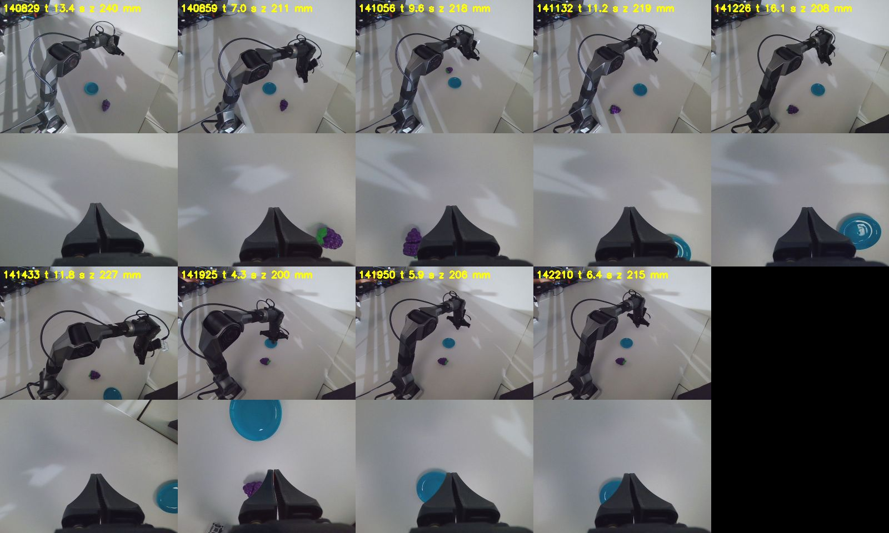
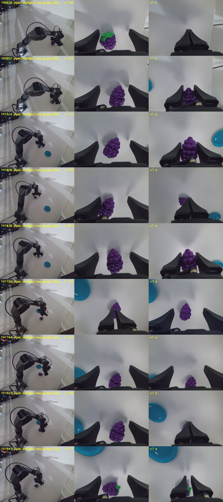
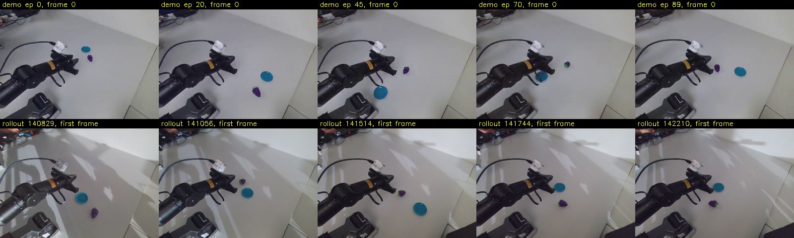

# Piper second table, first arm session (Tue 24 Nov): 3 of 18 rollouts placed the grape. In 9 the arm stopped part-way down with the gripper shut and stayed at the demos' carry height, mostly over the plate. In 5 the fingers closed beside or above the grape. The replay passes and every scene is inside the demos' range; the light is not: every rollout ran in afternoon sun with hard window stripes, which no demo and no augmentation has

**Status: thesis plan F1, the first rollouts of the new_grape policies** (registered and trained 23–24 Nov,
`7d7884a`). The user ran the session and asked Claude to analyse the logs afterwards.
- **Zero-shot:** every rollout replanned every 8 ticks without blending, so the commands are the
  policy's own (the user's rule, `runs/2026-11-03_piper_grape.md`).
- **Code:**
  - flowcl `7d7884a` on branch `piper-table2` (the server: `serve_piper.py`, live frames through the
    training video at crf 30).
  - PiperStudio `39b8826` on `policy-picker-groups`, with uncommitted changes:
    - the Policy tab's list narrowed to `policy.embodiments: ["agilex_piper_table2_*"]` (24 Nov);
    - the user's own frontend edits.
- **Analysis:**
  - new `scripts/hw/piper_session_diag.py` (`outcomes`, `scenes`, `hovers`), committed with this
    record;
  - `scripts/hw/piper_rollout_diag.py` (`logs`, `grip`, `demos`, `sheet`).
  - Their outputs are in `results/piper_rollouts/2026-11-24/diag/`.
- **Logs:** `results/piper_rollouts/2026-11-24/`, copied from `~/piper_rollouts/2026-11-24`. It holds
  18 rollouts, 1 replay and 2 probes, 14:08–14:23.
- **Not controlled:**
  - The light: afternoon sun through the windows. The demos were recorded 15:43–18:21 on 23 Nov.
  - Free scenes, placed by the user. Several scenes were repeated, so runs are not independent (§6).
  - Seed 0 ran twice only.
- **Not recorded:**
  - No run is annotated. Outcomes are read from the gripper, the end pose and the frames (§2).
  - The replay logged no camera frames, so whether it placed the grape is not known.

## 1. The session

| Policy (all `results/piper_daylight/`) | Checkpoint | sha256 | Runs |
|---|---|---|---:|
| `single__piper__new_grape_336__seed1` | `final` | `9b262155b82f2aee…` | 15 rollouts, the replay |
| `single__piper__new_grape_336__seed0` | `final` | `22e8a0465728c834…` | 2 rollouts |
| `single__piper__new_grape_trim_336__seed0` | `step_010000` | `a1199f29549cdd16…` | 1 rollout |

**Training of all three:**
- embodiment `agilex_piper_table2_336`: 336 px input, the operator corner masked, no crop;
- all 90 demos, none held out;
- 30k steps, daylight 0.3, AMP.

The trim run died at step 11.7k with a CUDA launch timeout (the GPU stall of 23–24 Nov), so only 5k
and 10k exist. Its one rollout is reported, not compared.

**The two probes** (`140803`, `141817`) were checked against `pick_sausage_v3` episode 10. The Scene
panel's dataset had not been switched to `new_grape`. They show only that frames and replies arrived in
time (deadline 388 ms at the first, cold request, then 114 ms).

**Replies:** p50 57–62 ms, max 105 ms, against a 400 ms deadline.

## 2. Outcomes

**Rules** (`piper_session_diag.py outcomes`):
- **hover:** the gripper never opened past 20 mm.
- **close:** once the gripper was wider than 60 mm, the first tick 10 mm below its widest opening so
  far. Session-1 demos only open to 66–77 mm, hence the low start.
- **grasp:** the width 1–2 s after the close is between 30 and 60 mm.
- **miss:** that width is below 30 mm.
- **opened, never closed:** no close, or the width is back above 60 mm.

| Outcome | Runs | Policy | Close: end z (mm) | Grape in the wrist frame at the close (px) |
|---|---:|---|---|---|
| grasp, lifted, released, back at the start pose | 3 | seed 1 | 99.5, 103.3, 105.4 | 16 508 – 19 984 |
| miss | 5 | seed 1 ×3, seed 0 ×2 | 106.7, 107.8, 108.8, 110.2, 120.4 | 10 523 – 16 233 |
| hover | 9 | seed 1 ×8, trim 10k | none | none |
| opened, never closed | 1 | seed 1 | none (a 10 mm dip at z 126) | none |

**Per policy:** seed 1 placed 3 of 15, seed 0 0 of 2. In all three grasps the grape lies on the plate
in the last front frame, 11–18 px from the plate's centre.

**The demos, by the same rules** (90 episodes, percentiles 5 / 50 / 95):
- the gripper opens at 3.1 / 4.1 / 6.2 s;
- it closes at end z 97.2 / 102.3 / 115.6 mm and holds 48.7 / 50.2 / 52.5 mm;
- the arm leaves the start pose at 0.2 / 0.8 / 1.6 s (max 1.9);
- it carries the grape at a z p90 of 172 / 238 / 290 mm.

## 3. What is not the cause

- **The arm and the executor.** Episode 10 replayed open-loop (`142339_replay`) passes every tolerance
  of the deploy spec (§6.3):
  - per joint RMSE 0.0016–0.0045 rad, max 0.0095–0.0121 rad;
  - gripper RMSE 0.49 mm, max 2.2 mm;
  - best lag 0 ticks, no tick limited.
- **Timing:** replies at p50 about 60 ms, and the arm trails its command by p95 0.048–0.076 rad. That
  is the demos' p95 of 0.076.
- **The limiter.** It changed 4.1–10.1 % of each rollout's ticks. In 16 of 18 runs, at least 87 % of
  those fall within 0.15 s after a chunk swap (62 % and 86 % in the other two). This matches 3 Nov
  (4.4–10.1 %) and 6 Nov (p50 9.7 %).
- **The placement** (§6): every grape started within 6–30 px of some demo's grape. The grape-to-plate
  distance, 50–143 px, is inside the demos' 35–283 px.
- **The camera view.** Frame 0 of the demos and the rollouts' first frames show the same view by eye
  (figure in §6). This was not measured.

## 4. Hover: the arm stops part-way down with the gripper shut and stays at carry height

**What it does:**
- Every rollout starts at end z 300 mm.
- The 9 hovering runs come down to 177–205 mm by 2.8–5.4 s. They never open the gripper and then sit
  at a p50 of 194–241 mm.
- That is the band where the demos carry the grape (z p90 172–290 mm). In the demos the gripper is
  then at about 50 mm, never shut.
- After a miss, the arm also settles at 198–205 mm with the gripper shut (4 of 5; the fifth was
  stopped at 161 mm).

**What the wrist camera shows part-way through each hover** (60 % of the run's frames;
`piper_session_diag.py hovers`):

| Wrist camera shows | Runs |
|---|---|
| the plate | `141132`, `141226`, `141433`, `141950`, `142210`, and `141925` (plate and grape) |
| the grape | `140859`, `141056` |
| neither | `140829` |

So in 6 of 9 the arm waits over the plate, with nothing in the gripper. In the demos the arm comes over
the plate only while carrying the grape.

**The plans are least consistent in the hovering runs.** Consecutive chunks disagree where the new one
takes over by a p50 (worst joint) of:

| Outcome | Disagreement at the swap (rad) |
|---|---|
| grasps | 0.011–0.016 |
| misses | 0.016–0.027 |
| hovers | 0.028–0.051 |
| opened, never closed | 0.068 |

The ordering holds for every run.

## 5. Misses: the fingers close on nothing, from higher up

- **In every miss, the gripper was open and the grape between or beside the fingers just before the
  close.**
  - The command went to 0–16 mm, and the measured width followed it, so the gripper was not slowed.
  - In 4 of 5, the arm stayed down until the fingers were shut. In `141847` it rose from 115 to 130 mm
    while closing.
  - The figure marks the close as `sheet` does: the first drop below 70 % of the widest opening. For
    `141720` that is an earlier dip at z 157; its close by §2's rule is at 106.7 mm.
- **The misses close higher:** end z 106.7–120.4 mm against 99.5–105.4 for the grasps.
  - The grape fills less of the wrist frame: 10.5–16.2 k px against 16.5–20.0 k px, in the last frame
    before the close (0.06–0.48 s before). The two ranges nearly touch (`141827` 16.2 k, `140957`
    16.5 k).
  - **Height alone does not explain it:** 17 demos closed at 107 mm or higher, and 16 of them held the
    grape.
  - In the wrist frame, the grape sits lower (nearer the palm) in 4 of 5 misses: y 343–364 px of 480,
    against 316–332 for the grasps. In the fifth, `141606`, it is beside the left finger at y 323.
- **Not measured:** the miss distance in mm. The 6 Nov aim measure (`piper_resolution_diag.py`) was
  built for the first table's camera pose.

**The two clean grasps waited about 5 s at the start pose** before moving (`141514` 5.3 s, `141639`
4.9 s). Every other rollout, and every demo (max 1.9 s), left within 1.7 s. Two runs are too few to
read anything into.

## 6. Scenes and light

**Scenes** (`piper_session_diag.py scenes`: grape and plate found by colour in the first front frame).
Consecutive runs whose grape and plate both moved less than 15 px count as one scene. "Demos within
40 px" counts demos whose grape started within 40 px of this one.

| Scene | Runs: outcome (policy) | Nearest demo grape (px) | Demos within 40 px |
|---:|---|---:|---:|
| 1 | `140829` hover, `140859` hover | 7–10 | 7 |
| 2 | `140928` miss | 8 | 12 |
| 3 | `140957` grasp | 12 | 8 |
| 4 | `141056` hover | 12 | 19 |
| 5 | `141132` hover, `141226` hover | 30 | 3 |
| 6 | `141433` hover | 25 | 2 |
| 7 | `141514` grasp | 9 | 17 |
| 8 | `141606` miss | 26 | 6 |
| 9 | `141639` grasp | 7 | 13 |
| 10 | `141720` miss, `141744` never closed, `141827` miss (seed 0) | 6–14 | 8–11 |
| 11 | `141847` miss (seed 0), `141925` hover (trim 10k), `141950` hover, `142210` hover | 6 | 8 |

**What the scenes show:**
- **Seed 1 repeats itself on a scene:** scenes 1, 5 and 11 hovered both times, and scene 10 missed or
  never closed.
- **Coverage does not separate the outcomes:**
  - Scenes 5 and 6 (2–3 demos near) hovered.
  - So did scene 4 (19 demos near), while scene 8 (6 near) closed.
- **Seed 0 against seed 1:** on scene 11, seed 0 tried a grasp where seed 1 hovered twice. That is one
  scene, one run.

**Light.** In every rollout's first frame, the sun puts hard-edged bright stripes and window shadows
across the table and the wall behind it. Frame 0 of every demo shows even light.

The light was measured over two regions, with the grape and the plate removed:
- **lower table:** rows 220–480, cols 210–640, fixed before looking;
- **whole table:** everything brighter than 110 grey in the median of the demos' frame 0, eroded by
  15 px. That is 172k px (56 % of the frame): the table and the white wall behind it. This region was
  added after the frames showed the stripes mostly above the lower one.

The measures are:
- **mean grey;**
- **sharp-edge share:** the share of pixels with Sobel > 40 on a 5 px blur;
- **ramp residual:** the relative std left after fitting a linear ramp, a + bx + cy, to a 15 px blur.
  The daylight augmentation multiplies by such a ramp.

| Measure (min – max) | 90 demos, frame 0 | 18 rollouts, first frame |
|---|---|---|
| lower table: mean grey | 143–153 | **129–136** |
| lower table: sharp-edge share | 0.010–0.025 | 0.005–0.048 |
| lower table: ramp residual | 0.044–0.084 | 0.035–0.092 |
| whole table: mean grey | 148–157 | 150–158 |
| whole table: sharp-edge share | 0.000–0.001 | **0.006–0.025** |
| whole table: ramp residual | 0.045–0.052 | **0.068–0.091** |

**Readings:**
- **Over the whole table, the two light-pattern measures do not overlap.** Every rollout has 5–23× the
  demos' largest sharp-edge share, and more structure than a ramp explains.
- The mean brightness overlaps over the whole table. The lower table was darker in every rollout
  (median 134 against 150 grey, 10 %), which is inside the colour jitter the augmentation already
  covers (±30 %).
- **What the augmentation does:** `flowcl/data/augment.py` applies, per image, a colour temperature, a
  linear brightness ramp, and brightness, contrast and saturation jitter. It makes no edges and no
  stripes. So these frames are outside what training showed the policy.
- **Light and outcome cannot be separated here:** the three grasps ran under the same light.

## 7. Reading

- **Two ways the policy fails:**
  - **Hover (9 of 18):** it skips the reach and grasp and goes to a carry posture, mostly over the
    plate, with the gripper shut. Its consecutive plans disagree most there.
  - **Miss (5 of 18):** it reaches the grape and closes, but from higher up, and the grape is not
    between the fingertips.
- **Ruled out:** the hardware, the executor, timing and placement. The replay passes, and every scene
  is near some demo's.
- **The one measured difference between the rollouts' inputs and the demos' is the light pattern.** It
  is also one the daylight augmentation does not model.
  - The 3 Nov milk session failed in a similar way under light unlike the recording's (lamp at demo
    time, daylight at test time). There the images alone moved the first plan 5–12×
    (`runs/2026-11-03_piper_milk_rollouts.md` §5).
  - Today's data cannot show that the light causes either failure.
- **Generalisation is untested offline:** nothing was held out, so the offline check (joint MAE
  0.006 rad on training episodes 0–5) measures fit only.

## 8. Next

1. **The same scenes under the recording's light** (room light, blinds closed, or the evening):
   - seed 0 and seed 1 on identical scenes, alternating;
   - each run annotated on the Policy tab;
   - the Scene panel's dataset set to `new_grape`.

   Fewer hovers in matched light point at the light; the same hovers point at the policy.
2. **One scene set up from a recorded episode** with the overlay. That makes the 3 Nov in-process test
   possible: the same state with the live images or the episode's (`piper_rollout_diag.py images`).
3. **If the light decides it:** demos on this table in afternoon sun, or an augmentation with hard-edged
   bright and dark stripes. Both are training-side changes and allowed by the zero-shot rule; the
   user's choice.
4. **The trim policy:** rerun it (about 4.5 h on ThinkStation-2, with no robot sessions meanwhile).
